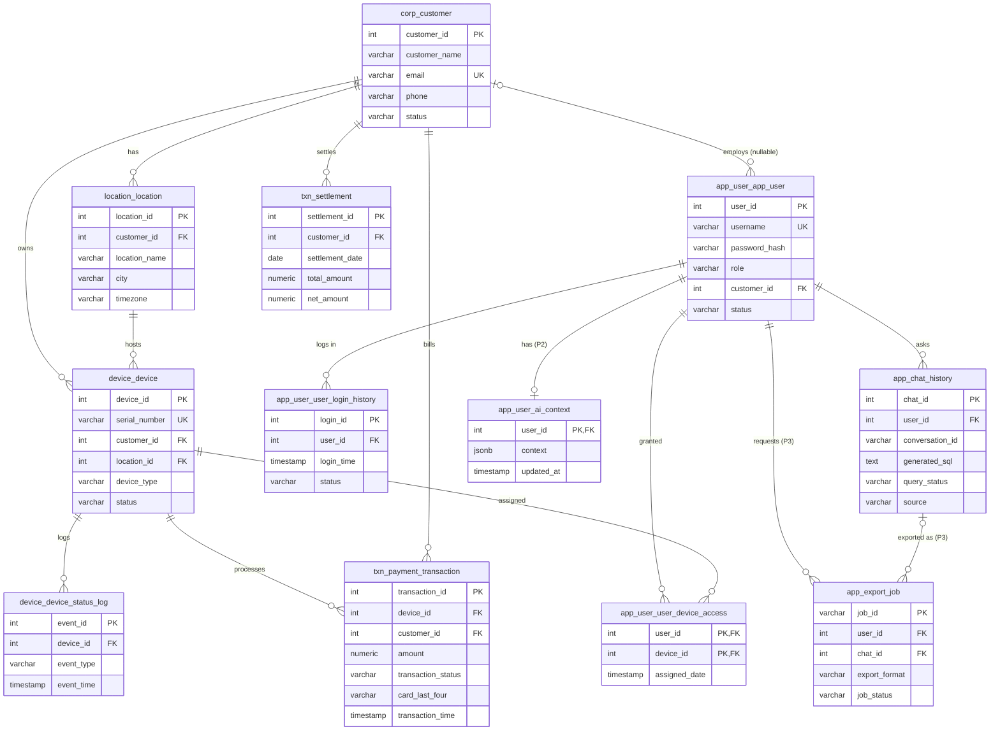

# DataTalk AI – Database Design

This document describes the **actual** database used by the DataTalk AI POC. It is derived from the SQL
scripts in `database\` and from the SQL issued by the Java code in `src\main\java`. Where the scripts and
the running database can differ, this is stated explicitly.

> **No credentials are stored in this document.** Authorized team members obtain database credentials from
> the Neon console (project owner) or the team's secure secret store — never from the repository.

---

## 1. Database Overview

| Item | Value |
|------|-------|
| Provider | Neon (serverless PostgreSQL) |
| PostgreSQL version | 18 (the migration scripts require PostgreSQL 16+ for `GRANT … WITH INHERIT FALSE, SET TRUE`) |
| Region | AWS `ap-southeast-1` (Asia Pacific – Singapore) |
| Database name | `neondb` |
| Host (pooled, used by the app) | `ep-lingering-brook-b3tgnze7-pooler.c-4.ap-southeast-1.aws.neon.tech` |
| Port | `5432` |
| SSL | Required (`sslmode=require`) |
| Object owner | `neondb_owner` (owns all schemas/tables; runs all scripts) |
| Application login role | `user_datatalk` |
| Read-only reporting role | `datatalk_ro` (used via `SET LOCAL ROLE`, see §8) |
| JDBC driver | `org.postgresql.Driver` |
| Connection pool | HikariCP (max 20, min idle 5, connection timeout 30 s, idle timeout 10 min, max lifetime 30 min) |

### 1.1 JDBC URL format

```
jdbc:postgresql://<host>:5432/<database>?sslmode=require
```

The default in `application.properties` is the pooled Neon host above with database `neondb`.

### 1.2 Configuration (`src\main\resources\application.properties`)

| Property | Value / source |
|----------|----------------|
| `spring.datasource.url` | `${DB_URL:<pooled Neon JDBC URL>}` |
| `spring.datasource.username` | `${DB_USER:user_datatalk}` |
| `spring.datasource.password` | `${DB_PASSWORD:…}` – always supply `DB_PASSWORD` explicitly |
| `app.reporting.read-only-role` | `${REPORT_DB_ROLE:datatalk_ro}` |
| `spring.config.import` | `optional:file:.env[.properties]` – loads a local, **git-ignored** `.env` file (`KEY=value` lines). Real environment variables take precedence. |

**Environment variables (names only):**

| Variable | Required | Purpose |
|----------|----------|---------|
| `DB_URL` | Optional (defaults to the Neon pooled URL) | JDBC URL |
| `DB_USER` | Optional (defaults to `user_datatalk`) | Database login |
| `DB_PASSWORD` | **Yes** | Password of the login role |
| `REPORT_DB_ROLE` | Optional (defaults to `datatalk_ro`) | Role switched to for report queries |

> Note: `DB_PASSWORD` has no default in `application.properties`; provide it via an environment variable or
> the git-ignored `.env` file. An older committed version contained a password default, so rotate the
> password in the Neon console.

There is **one** datasource only. The application does **not** log in as `datatalk_ro`; it connects as
`user_datatalk` and switches role per report transaction (see §8).

---

## 2. Schemas

| Schema | Purpose (from `COMMENT ON SCHEMA`) | Reportable by AI/reports? |
|--------|------------------------------------|---------------------------|
| `corp` | Corporate and customer information | Yes |
| `location` | Location and branch information | Yes |
| `device` | Device management and status tracking | Yes |
| `txn` | Payment transactions and settlements | Yes |
| `app_user` | User management and authentication | No (blocked) |
| `app` | Application-specific data (chat history, AI context, export jobs) | No (blocked) |

Approved reporting schemas are configured in `app.reporting.approved-schemas=corp,location,device,txn`.

---

## 3. Tables

Conventions: all `SERIAL` keys are `INTEGER` backed by a sequence. `TIMESTAMP` = `timestamp without time zone`.
`DECIMAL(15,2)` = `numeric(15,2)`. "Created by" refers to the script that creates/alters the table.

### 3.1 `corp.customer`
Created by `neon-schema.sql`. Master customer table for the payment system.

| Column | Type | Null | Default | Constraints / meaning |
|--------|------|------|---------|-----------------------|
| `customer_id` | SERIAL (INTEGER) | NOT NULL | sequence | **PK** – unique customer identifier |
| `customer_name` | VARCHAR(255) | NOT NULL | | Legal business name |
| `email` | VARCHAR(255) | NOT NULL | | **UNIQUE** – primary business email (**blocked column**) |
| `phone` | VARCHAR(20) | NULL | | Primary business phone (**blocked column**) |
| `status` | VARCHAR(50) | NOT NULL | `'ACTIVE'` | CHECK IN (`ACTIVE`,`INACTIVE`,`SUSPENDED`,`ARCHIVED`) |
| `created_date` | TIMESTAMP | NOT NULL | `CURRENT_TIMESTAMP` | |
| `updated_date` | TIMESTAMP | NULL | `CURRENT_TIMESTAMP` | Not maintained by a trigger |

Indexes: `idx_customer_email (email)`, `idx_customer_status (status)`, `idx_customer_created_date (created_date)` (+ PK and UNIQUE indexes).

### 3.2 `location.location`
Created by `neon-schema.sql`. Customer locations and branches.

| Column | Type | Null | Default | Constraints / meaning |
|--------|------|------|---------|-----------------------|
| `location_id` | SERIAL | NOT NULL | sequence | **PK** |
| `customer_id` | INTEGER | NOT NULL | | **FK** → `corp.customer(customer_id)` ON DELETE CASCADE |
| `location_name` | VARCHAR(255) | NOT NULL | | Name of the location/branch |
| `city` | VARCHAR(100) | NULL | | |
| `state` | VARCHAR(100) | NULL | | |
| `timezone` | VARCHAR(50) | NULL | `'UTC'` | Timezone for transaction reporting |
| `created_date` | TIMESTAMP | NOT NULL | `CURRENT_TIMESTAMP` | |

Indexes: `idx_location_customer_id (customer_id)`, `idx_location_city (city)`.

### 3.3 `app_user.app_user`
Created by `neon-schema.sql`. Application users with role-based access.

| Column | Type | Null | Default | Constraints / meaning |
|--------|------|------|---------|-----------------------|
| `user_id` | SERIAL | NOT NULL | sequence | **PK** |
| `username` | VARCHAR(100) | NOT NULL | | **UNIQUE** – login name |
| `password_hash` | VARCHAR(255) | NOT NULL | | BCrypt hash – never plain text |
| `full_name` | VARCHAR(255) | NOT NULL | | |
| `email` | VARCHAR(255) | NULL | | **UNIQUE** |
| `role` | VARCHAR(50) | NOT NULL | | CHECK IN (`ADMIN`,`BUSINESS`,`MANAGER`,`CUSTOMER`) |
| `customer_id` | INTEGER | NULL | | **FK** → `corp.customer(customer_id)` ON DELETE SET NULL (NULL for ADMIN) |
| `status` | VARCHAR(50) | NOT NULL | `'ACTIVE'` | CHECK IN (`ACTIVE`,`INACTIVE`,`LOCKED`,`PENDING`) |
| `created_date` | TIMESTAMP | NOT NULL | `CURRENT_TIMESTAMP` | |
| `updated_date` | TIMESTAMP | NULL | `CURRENT_TIMESTAMP` | |

Indexes: `idx_app_user_username`, `idx_app_user_email`, `idx_app_user_customer_id`, `idx_app_user_role`, `idx_app_user_status`.

### 3.4 `app_user.user_login_history`
Created by `neon-schema.sql`. Audit log for login/logout events.

| Column | Type | Null | Default | Constraints / meaning |
|--------|------|------|---------|-----------------------|
| `login_id` | SERIAL | NOT NULL | sequence | **PK** |
| `user_id` | INTEGER | NOT NULL | | **FK** → `app_user.app_user(user_id)` ON DELETE CASCADE |
| `login_time` | TIMESTAMP | NOT NULL | `CURRENT_TIMESTAMP` | |
| `logout_time` | TIMESTAMP | NULL | | Set on logout |
| `ip_address` | VARCHAR(45) | NULL | | IPv4/IPv6 |
| `status` | VARCHAR(50) | NOT NULL | | CHECK IN (`SUCCESS`,`FAILED`,`LOCKED`,`INACTIVE_USER`) |
| `failure_reason` | VARCHAR(255) | NULL | | Reason for a failed login |
| `channel` | VARCHAR(50) | NULL | `'WEB'` | |
| `created_date` | TIMESTAMP | NOT NULL | `CURRENT_TIMESTAMP` | |

Indexes: `idx_login_history_user_id`, `idx_login_history_login_time`, `idx_login_history_status`.

### 3.5 `app_user.user_device_access`
Created by `neon-schema.sql`. Many-to-many mapping of users to the devices they may access.

| Column | Type | Null | Default | Constraints / meaning |
|--------|------|------|---------|-----------------------|
| `user_id` | INTEGER | NOT NULL | | **PK (part)**, **FK** → `app_user.app_user(user_id)` ON DELETE CASCADE |
| `device_id` | INTEGER | NOT NULL | | **PK (part)**, **FK** `fk_user_device_access_device_id` → `device.device(device_id)` ON DELETE CASCADE (added by `ALTER TABLE` at the end of the script) |
| `assigned_date` | TIMESTAMP | NOT NULL | `CURRENT_TIMESTAMP` | |

PK: `(user_id, device_id)`. Indexes: `idx_user_device_user_id`, `idx_user_device_device_id`.

### 3.6 `device.device`
Created by `neon-schema.sql`. Physical payment devices deployed at locations.

| Column | Type | Null | Default | Constraints / meaning |
|--------|------|------|---------|-----------------------|
| `device_id` | SERIAL | NOT NULL | sequence | **PK** |
| `serial_number` | VARCHAR(100) | NOT NULL | | **UNIQUE** – manufacturer serial number |
| `customer_id` | INTEGER | NOT NULL | | **FK** → `corp.customer` ON DELETE CASCADE |
| `location_id` | INTEGER | NOT NULL | | **FK** → `location.location` ON DELETE CASCADE |
| `device_type` | VARCHAR(50) | NOT NULL | | CHECK IN (`POS_TERMINAL`,`MOBILE_READER`,`PAYMENT_GATEWAY`,`ATM`) |
| `firmware_version` | VARCHAR(50) | NULL | | |
| `status` | VARCHAR(50) | NOT NULL | `'INACTIVE'` | CHECK IN (`ACTIVE`,`INACTIVE`,`MAINTENANCE`,`DECOMMISSIONED`,`ERROR`) |
| `activated_date` | TIMESTAMP | NULL | | |
| `last_communication_time` | TIMESTAMP | NULL | | |
| `created_date` | TIMESTAMP | NOT NULL | `CURRENT_TIMESTAMP` | |

Indexes: `idx_device_customer_id`, `idx_device_location_id`, `idx_device_serial_number`, `idx_device_status`.

### 3.7 `device.device_status_log`
Created by `neon-schema.sql`. Device status change event history.

| Column | Type | Null | Default | Constraints / meaning |
|--------|------|------|---------|-----------------------|
| `event_id` | SERIAL | NOT NULL | sequence | **PK** |
| `device_id` | INTEGER | NOT NULL | | **FK** → `device.device` ON DELETE CASCADE |
| `event_type` | VARCHAR(50) | NOT NULL | | CHECK IN (`ACTIVATED`,`DEACTIVATED`,`HEARTBEAT`,`ERROR`,`MAINTENANCE`,`COMMUNICATION_LOST`) |
| `event_time` | TIMESTAMP | NOT NULL | `CURRENT_TIMESTAMP` | |
| `description` | TEXT | NULL | | |
| `created_date` | TIMESTAMP | NOT NULL | `CURRENT_TIMESTAMP` | |

Indexes: `idx_device_status_log_device_id`, `idx_device_status_log_event_time`, `idx_device_status_log_event_type`.

### 3.8 `txn.payment_transaction`
Created by `neon-schema.sql`. Payment transactions processed through devices.

| Column | Type | Null | Default | Constraints / meaning |
|--------|------|------|---------|-----------------------|
| `transaction_id` | SERIAL | NOT NULL | sequence | **PK** |
| `device_id` | INTEGER | NOT NULL | | **FK** → `device.device` ON DELETE RESTRICT |
| `customer_id` | INTEGER | NOT NULL | | **FK** → `corp.customer` ON DELETE RESTRICT |
| `amount` | DECIMAL(15,2) | NOT NULL | | Amount in base currency |
| `card_type` | VARCHAR(50) | NULL | | CHECK IN (`VISA`,`MASTERCARD`,`AMEX`,`DISCOVER`,`DEBIT`,`PREPAID`,`OTHER`) |
| `entry_mode` | VARCHAR(50) | NULL | | CHECK IN (`SWIPE`,`INSERT`,`TAP`,`ONLINE`,`MANUAL`,`QR`) |
| `transaction_status` | VARCHAR(50) | NOT NULL | | CHECK IN (`APPROVED`,`DECLINED`,`PENDING`,`REFUNDED`,`FAILED`,`CANCELLED`) |
| `decline_reason` | VARCHAR(255) | NULL | | |
| `card_last_four` | VARCHAR(4) | NULL | | Last 4 card digits (**blocked column**) |
| `transaction_time` | TIMESTAMP | NOT NULL | `CURRENT_TIMESTAMP` | |
| `created_date` | TIMESTAMP | NOT NULL | `CURRENT_TIMESTAMP` | |

Indexes: `idx_payment_txn_device_id`, `idx_payment_txn_customer_id`, `idx_payment_txn_txn_status`, `idx_payment_txn_transaction_time`, `idx_payment_txn_amount`.

### 3.9 `txn.settlement`
Created by `neon-schema.sql`. Settlement records per customer and period.

| Column | Type | Null | Default | Constraints / meaning |
|--------|------|------|---------|-----------------------|
| `settlement_id` | SERIAL | NOT NULL | sequence | **PK** |
| `customer_id` | INTEGER | NOT NULL | | **FK** → `corp.customer` ON DELETE RESTRICT |
| `settlement_date` | DATE | NOT NULL | | Date of the settlement period |
| `total_amount` | DECIMAL(15,2) | NOT NULL | | Total transaction amount |
| `fees` | DECIMAL(15,2) | NOT NULL | `0` | Processing fees deducted |
| `net_amount` | DECIMAL(15,2) | NOT NULL | | |
| `status` | VARCHAR(50) | NOT NULL | `'PENDING'` | CHECK IN (`PENDING`,`PROCESSING`,`COMPLETED`,`FAILED`,`CANCELLED`) |
| `created_date` | TIMESTAMP | NOT NULL | `CURRENT_TIMESTAMP` | |

Indexes: `idx_settlement_customer_id`, `idx_settlement_settlement_date`, `idx_settlement_status`.
No UNIQUE constraint on `(customer_id, settlement_date)`.

### 3.10 `app.chat_history`
Created by `neon-schema.sql`; **extended by `phase2-migration.sql`** (columns marked *P2*). One row per question
(AI, cached or predefined report). Never stores report data.

| Column | Type | Null | Default | Script | Constraints / meaning |
|--------|------|------|---------|--------|-----------------------|
| `chat_id` | SERIAL | NOT NULL | sequence | schema | **PK** |
| `user_id` | INTEGER | NOT NULL | | schema | **FK** → `app_user.app_user(user_id)` ON DELETE CASCADE |
| `user_question` | TEXT | NOT NULL | | schema | Natural-language question (or predefined report name) |
| `generated_sql` | TEXT | NULL | | schema | SQL generated by AI / predefined report SQL |
| `query_status` | VARCHAR(50) | NULL | `'PENDING'` | schema | CHECK IN (`PENDING`,`EXECUTED`,`FAILED`,`INVALID_SQL`) |
| `query_result` | TEXT | NULL | | schema | Not written by the application (always NULL for app rows) |
| `created_at` | TIMESTAMP | NOT NULL | `CURRENT_TIMESTAMP` | schema | |
| `conversation_id` | VARCHAR(64) | NULL | | P2 | Groups questions of one conversation (app-generated) |
| `ai_interpretation` | TEXT | NULL | | P2 | How the AI understood the question |
| `report_title` | VARCHAR(255) | NULL | | P2 | AI-proposed title or predefined report name |
| `explanation` | TEXT | NULL | | P2 | Short explanation shown to the user |
| `chart_type` | VARCHAR(20) | NULL | | P2 | `table`, `bar`, `line` or `pie` |
| `row_count` | INTEGER | NULL | | P2 | Total rows returned by the validated query |
| `error_message` | TEXT | NULL | | P2 | Format `"[CODE] message"` (e.g. `[RESTRICTED_COLUMN] …`); no secrets |
| `ai_provider` | VARCHAR(30) | NULL | | P2 | Compact `provider:model` (vendor prefix dropped, truncated to 30), or `CACHE` / `PREDEFINED` |
| `source` | VARCHAR(30) | NULL | `'AI'` | P2 | `AI`, `CACHE` (reused SQL) or `PREDEFINED` |
| `duration_ms` | INTEGER | NULL | | P2 | End-to-end processing time |

Indexes: `idx_chat_history_user_id (user_id)`, `idx_chat_history_created_at (created_at)`,
*P2:* `idx_chat_history_conversation (conversation_id)`, `idx_chat_history_user_created (user_id, created_at DESC)`.

**Status mapping.** The Phase 1 CHECK constraint was not changed, so the app (`ChatStatus`) maps its outcomes:

| App outcome | `query_status` stored |
|-------------|-----------------------|
| `SUCCESS` | `EXECUTED` |
| `REJECTED` (SQL failed validation) | `INVALID_SQL` |
| `NOT_ANSWERABLE`, `AI_ERROR`, `EXECUTION_ERROR` | `FAILED` |

The detailed code is kept in `error_message` (`[CODE] message`). Note: `phase2-migration.sql` sets the column
comment of `query_status` to "SUCCESS, REJECTED, AI_ERROR, EXECUTION_ERROR or NOT_ANSWERABLE"; that comment
describes the app-level outcomes, **not** the stored values (the CHECK constraint still applies).

### 3.11 `app.user_ai_context`
**Created by `phase2-migration.sql`.** Compact AI context per user (preferences + short conversation summary).
Never stores passwords, API keys or payment card data.

| Column | Type | Null | Default | Constraints / meaning |
|--------|------|------|---------|-----------------------|
| `user_id` | INTEGER | NOT NULL | | **PK** and **FK** → `app_user.app_user(user_id)` ON DELETE CASCADE (one row per user) |
| `context` | JSONB | NOT NULL | `'{}'::jsonb` | `{conversationId, preferences{}, recentTurns[{chatId,question,title,sql}], topics{}, updatedAt}` – last 3 turns, SQL ≤ 1500 chars, text ≤ 300 chars, sanitized |
| `updated_at` | TIMESTAMP | NOT NULL | `CURRENT_TIMESTAMP` | |

Written with `INSERT … ON CONFLICT (user_id) DO UPDATE`.

### 3.12 `app.export_job`
**Created by `phase3-migration.sql`** (must be run by `neondb_owner` in the Neon SQL Editor).

> **Status:** at the time of writing `phase3-migration.sql` had **not yet been run** on the Neon database.
> The application works without this table: `ExportJobRepository` persistence is best-effort and logs a
> warning (`Export job persistence (…) failed - run database/phase3-migration.sql?`), and Query Analytics
> returns an empty export list.

| Column | Type | Null | Default | Constraints / meaning |
|--------|------|------|---------|-----------------------|
| `job_id` | VARCHAR(36) | NOT NULL | | **PK** – UUID generated by the application |
| `user_id` | INTEGER | NOT NULL | | **FK** → `app_user.app_user(user_id)` ON DELETE CASCADE; only this user may download |
| `chat_id` | INTEGER | NULL | | **FK** → `app.chat_history(chat_id)` ON DELETE SET NULL |
| `report_name` | VARCHAR(255) | NOT NULL | | Report title at export time (truncated to 255 by the app) |
| `export_format` | VARCHAR(10) | NOT NULL | | CHECK IN (`PDF`,`EXCEL`) |
| `job_status` | VARCHAR(20) | NOT NULL | | CHECK IN (`RUNNING`,`COMPLETED`,`FAILED`,`EXPIRED`) |
| `delivery` | VARCHAR(20) | NOT NULL | `'BACKGROUND'` | CHECK IN (`DIRECT`,`BACKGROUND`) |
| `row_count` | INTEGER | NULL | | Rows written to the file |
| `created_date` | TIMESTAMP | NOT NULL | `CURRENT_TIMESTAMP` | |
| `completed_date` | TIMESTAMP | NULL | | When finished or failed |
| `file_location` | VARCHAR(500) | NULL | | Server file path for background exports (NULL for direct downloads) |
| `error_message` | TEXT | NULL | | Failure reason |

Index: `idx_export_job_user_created (user_id, created_date DESC)`.

### 3.13 Views (created by `neon-schema.sql`)

| View | Definition summary |
|------|--------------------|
| `app_user.v_user_details` | `app_user.app_user` LEFT JOIN `corp.customer` (user fields + `customer_name`, `customer_email`) |
| `device.v_device_summary` | Per customer: total / active / inactive / maintenance device counts |
| `txn.v_transaction_summary` | Per customer per day: total, approved, failed (DECLINED+FAILED) counts, total and approved amount |

Views are **not** part of the AI reporting catalog (`SchemaMetadataService` only reads `BASE TABLE`s).

---

## 4. Relationships

| Child table | Column | Parent | ON DELETE |
|-------------|--------|--------|-----------|
| `location.location` | `customer_id` | `corp.customer` | CASCADE |
| `app_user.app_user` | `customer_id` (nullable) | `corp.customer` | SET NULL |
| `device.device` | `customer_id` | `corp.customer` | CASCADE |
| `device.device` | `location_id` | `location.location` | CASCADE |
| `device.device_status_log` | `device_id` | `device.device` | CASCADE |
| `txn.payment_transaction` | `device_id` | `device.device` | RESTRICT |
| `txn.payment_transaction` | `customer_id` | `corp.customer` | RESTRICT |
| `txn.settlement` | `customer_id` | `corp.customer` | RESTRICT |
| `app_user.user_login_history` | `user_id` | `app_user.app_user` | CASCADE |
| `app_user.user_device_access` | `user_id` | `app_user.app_user` | CASCADE |
| `app_user.user_device_access` | `device_id` | `device.device` | CASCADE |
| `app.chat_history` | `user_id` | `app_user.app_user` | CASCADE |
| `app.user_ai_context` *(P2)* | `user_id` | `app_user.app_user` | CASCADE |
| `app.export_job` *(P3)* | `user_id` | `app_user.app_user` | CASCADE |
| `app.export_job` *(P3)* | `chat_id` (nullable) | `app.chat_history` | SET NULL |

Because `txn.*` uses RESTRICT, a customer or device with transactions/settlements cannot be deleted.



*(Mermaid entity names use `_` instead of `.`: e.g. `app_user_ai_context` = `app.user_ai_context`.)*

---

## 5. Which Component Uses Each Table

All application SQL uses Spring `JdbcTemplate` (no JPA/ORM). "Reporting" means queries generated by AI,
reused from cache or taken from predefined reports, validated by `SqlSafetyValidator` and executed by
`ReportExecutionService` as `datatalk_ro`.

| Table | Component(s) | Access |
|-------|--------------|--------|
| `corp.customer` | `CustomerRepository` (dashboard), `SchemaMetadataService`, reporting | SELECT |
| `location.location` | `CustomerRepository` (location count), reporting | SELECT |
| `device.device` | `CustomerRepository` (device counts), `AccessPolicyService` (join), reporting (also scope sub-query) | SELECT |
| `device.device_status_log` | Reporting | SELECT |
| `txn.payment_transaction` | `CustomerRepository` (30-day stats, totals), reporting | SELECT |
| `txn.settlement` | Reporting | SELECT |
| `app_user.app_user` | `UserRepository` (login by username, `findById`, `findAll`) | SELECT |
| `app_user.user_login_history` | `UserRepository` (login attempt INSERT, logout UPDATE) | INSERT, UPDATE |
| `app_user.user_device_access` | `AccessPolicyService` (devices of CUSTOMER users) | SELECT |
| `app.chat_history` | `ChatHistoryRepository` (insert, own history, SQL reuse lookup), `QueryAnalyticsService` (admin analytics) | INSERT, SELECT |
| `app.user_ai_context` | `UserAiContextService` | SELECT, INSERT … ON CONFLICT UPDATE |
| `app.export_job` | `ExportJobRepository` (insert/complete/expire/find own job), `QueryAnalyticsService` (export stats, optional) | INSERT, UPDATE, SELECT |

`SchemaMetadataService` also reads `information_schema.columns/tables` and `pg_description` (comments) and runs
`SELECT DISTINCT` (≤ 20 values) on categorical columns (`status`, `transaction_status`, `card_type`,
`entry_mode`, `device_type`, `event_type`) to help the AI.

---

## 6. Sample Data (`sample-data.sql`)

Counts are taken from the script. Values marked "≈" use `random()` and vary per run. IDs assume an empty,
freshly created schema (sequences start at 1).

| Table | Rows | Characteristics |
|-------|------|-----------------|
| `corp.customer` | 5 | TechPay Solutions (1), RetailHub Inc (2), Restaurant Group USA (3), Gas Station Network (4), Quick Commerce Express (5); all `ACTIVE`; created 120/90/60/45/30 days ago |
| `location.location` | 15 | Customer 1: 3 (New York, Brooklyn, Newark) · 2: 4 (Los Angeles, Santa Monica, San Francisco, Chicago) · 3: 3 (New York, Miami, Austin) · 4: 3 (Houston, Dallas, San Antonio) · 5: 2 (Seattle, Denver); US timezones |
| `app_user.app_user` | 6 | Demo users (see below); all `ACTIVE`, same BCrypt hash |
| `device.device` | 60 | Customer 1: 20 (`DEV-TP-0001..0020`, ids 1–20) · 2: 15 (`DEV-RH-0021..0035`) · 3: 12 (`DEV-RG-0036..0047`) · 4: 8 (`DEV-GS-0048..0055`) · 5: 5 (`DEV-QC-0056..0060`). Types: POS_TERMINAL / MOBILE_READER / PAYMENT_GATEWAY (no ATM). Status ≈85–92 % `ACTIVE`, rest `INACTIVE`/`MAINTENANCE` |
| `device.device_status_log` | 1,500 | `device_id` cycles 1..60 (25 events each); event types cycle: HEARTBEAT 668, ERROR 167, ACTIVATED 167, DEACTIVATED 166, MAINTENANCE 166, COMMUNICATION_LOST 166; random times in last 120 days; descriptions are synthetic and not aligned with `event_type` |
| `txn.payment_transaction` | 10,000 | `device_id` cycles 1..60, customer derived from the device → per customer 3,340 / 2,505 / 1,997 / 1,328 / 830. Amount 10.00–510.00. `card_type` cycles VISA/MASTERCARD/AMEX/DISCOVER/DEBIT (2,000 each); `entry_mode` cycles all 6 modes. Status ≈85 % APPROVED, ≈14.5 % DECLINED, ≈0.4 % FAILED, ≈0.01 % REFUNDED (independent `random()` calls; no PENDING/CANCELLED). `decline_reason` ≈15 % non-null, chosen independently of status. `card_last_four` deterministic 1000–9999. Time: random in last 120 days |
| `txn.settlement` | ≈600 (max 605) | One row per customer per day (121-day window) that has APPROVED transactions; `fees` = 2.5 %, `net_amount` = total − fees; ≈95 % `COMPLETED`, else `PENDING` |
| `app_user.user_device_access` | ≈52 | Random ≈70 % of the 75 eligible (non-admin user × own-customer device) combinations; ADMIN has none |
| `app.chat_history` | 5 | Users 2–6, status `EXECUTED`, example SQL; Phase 2 columns NULL except `source` (`'AI'` default applied by the migration) |
| `app_user.user_login_history` | 800 | `user_id` cycles 1..6 (134/134/133/133/133/133); ≈95 % SUCCESS, ≈4.9 % FAILED, ≈0.1 % LOCKED; channel WEB; synthetic private/test IPs; `logout_time` ≈95 % set (random, not tied to `login_time`) |
| `app.user_ai_context`, `app.export_job` | 0 | Filled by the application at runtime |

### Demo users

Passwords are **not** listed here – see `docs\DEMO_USERS_GUIDE.md`.

| user_id | Username | Full name | Role | customer_id | Customer |
|---------|----------|-----------|------|-------------|----------|
| 1 | `admin_user` | Admin System | ADMIN | NULL | – (all customers) |
| 2 | `techpay_manager` | John Manager | BUSINESS | 1 | TechPay Solutions |
| 3 | `techpay_customer` | Sarah Customer | CUSTOMER | 1 | TechPay Solutions |
| 4 | `retail_manager` | Mike Retail | MANAGER | 2 | RetailHub Inc |
| 5 | `restaurant_owner` | David Chef | BUSINESS | 3 | Restaurant Group USA |
| 6 | `gas_operator` | Emma Operator | CUSTOMER | 4 | Gas Station Network |

Customer 5 (Quick Commerce Express) has no user.

---

## 7. Initialization Scripts and Execution Order

All scripts are run manually in the **Neon SQL Editor** as the owner role `neondb_owner`.

| # | Script | Purpose | Re-runnable? |
|---|--------|---------|--------------|
| 1 | `database\neon-schema.sql` | 6 schemas, 9 tables, indexes, comments, FK on `user_device_access.device_id`, 3 views | No (`CREATE TABLE` without `IF NOT EXISTS`) |
| 2 | `database\sample-data.sql` | Demo data (§6) + count summary query | No (would duplicate / violate UNIQUE) |
| 3 | `database\permissions.sql` | Creates `datatalk_ro` and its SELECT grants | No (`CREATE ROLE` fails if it exists) |
| 4 | `database\phase2-migration.sql` | Extends `app.chat_history`, creates `app.user_ai_context`, grants for `user_datatalk`, hardens `datatalk_ro` | Yes (idempotent) |
| 5 | `database\phase3-migration.sql` | Creates `app.export_job` and its grants (**not yet run on Neon at time of writing**) | Yes (idempotent) |
| – | `database\verify-demo-users.sql` | Read-only verification: users, counts, BCrypt format, orphan checks | Yes (SELECT only) |

`database\README.md` documents steps 1–3 (with `permissions.sql` described as optional); the order of steps 4
and 5 comes from the headers of the migration scripts ("AFTER neon-schema.sql, sample-data.sql and
permissions.sql" and "AFTER phase2-migration.sql"). `permissions.sql` must run before `phase2-migration.sql`
because the latter grants/alters `datatalk_ro`.

---

## 8. Roles and Permissions

### 8.1 Read-only reporting role `datatalk_ro`

Defined by `permissions.sql`, re-applied/hardened by `phase2-migration.sql` and `phase3-migration.sql`.

| Setting | Value | Script |
|---------|-------|--------|
| Role attributes | `LOGIN NOINHERIT` (no password is set by the script) | permissions |
| Schema USAGE | `corp`, `location`, `device`, `txn` | permissions, phase2 |
| Table privileges | `SELECT` on all tables and views in those 4 schemas | permissions, phase2 |
| Default privileges | Future tables and sequences in those 4 schemas get `SELECT` (for objects created by the script runner) | permissions |
| `app` schema | `REVOKE ALL` on schema and all tables; `REVOKE ALL ON app.export_job` | phase2, phase3 |
| `app_user` schema | `REVOKE ALL` on schema and all tables | phase2 |
| `default_transaction_read_only` | `on` (role setting) | phase2 |
| `statement_timeout` | `30s` (role setting) | phase2 |
| Membership | `GRANT datatalk_ro TO user_datatalk WITH INHERIT FALSE, SET TRUE` | phase2 |

**How the app uses it.** There is no separate reporting datasource and the app never logs in as `datatalk_ro`.
`ReportExecutionService.runReadOnly()` executes every report/AI/export query on the normal `user_datatalk`
pool inside a transaction that runs:

```sql
SET TRANSACTION READ ONLY;
SET LOCAL statement_timeout = '30s';   -- app.reporting.statement-timeout-seconds
SET LOCAL ROLE datatalk_ro;            -- app.reporting.read-only-role / REPORT_DB_ROLE
```

plus a JDBC query timeout of 35 s. Role-level settings (`default_transaction_read_only`, `statement_timeout`)
apply only to direct `datatalk_ro` logins; for `SET ROLE` the app sets the equivalents explicitly. If the role
is missing or not grantable, users get "The read-only reporting role is not configured. Run
database/phase2-migration.sql as the database owner."

Non-report queries (login, dashboard counts, chat history, AI context, export jobs, analytics) run directly as
`user_datatalk`.

### 8.2 Application role `user_datatalk`

Privileges granted **by the scripts**:

| Object | Privileges | Script |
|--------|------------|--------|
| Schema `app` | USAGE | phase2 |
| `app.chat_history`, `app.user_ai_context` | SELECT, INSERT, UPDATE, DELETE | phase2 |
| All sequences in `app` (e.g. `chat_history_chat_id_seq`) | USAGE, SELECT | phase2 |
| `app.export_job` | SELECT, INSERT, UPDATE (no DELETE) | phase3 |
| Role `datatalk_ro` | membership with `INHERIT FALSE, SET TRUE` | phase2 |

**Not granted by any script** but required by the code (inferred from the SQL it issues; these were set up
outside the repository scripts on Neon):

- USAGE on `corp`, `location`, `device`, `txn`, `app_user`.
- SELECT on `corp.customer`, `location.location`, `device.device`, `txn.payment_transaction`,
  `app_user.app_user`, `app_user.user_device_access`, and on `information_schema`/comments of the approved schemas (metadata).
- SELECT, INSERT, UPDATE on `app_user.user_login_history` (+ USAGE on `user_login_history_login_id_seq`).

The role itself (and its password) is created in the Neon console; the scripts do not create it.

---

## 9. Data Access Restrictions Enforced by the Application

Implemented in `src\main\java\com\datatalk\datatalkai\reporting\` and applied to every AI, cached and
predefined report query and to exports.

### 9.1 Approved tables and blocked columns (`SchemaMetadataService`)
- The reporting catalog is read from PostgreSQL metadata for schemas `corp, location, device, txn`
  (base tables only). Tables without `customer_id` or `device_id` are skipped (fail closed). Result: the 6
  business tables of §3.1, 3.2, 3.6–3.9.
- **Blocked columns** (`app.reporting.blocked-columns`) are removed from the catalog and can never be selected:
  `txn.payment_transaction.card_last_four`, `corp.customer.email`, `corp.customer.phone`.

### 9.2 Role-based table access (`AccessPolicyService`)
- User id comes from the server-side session; role, customer and status are re-read from
  `app_user.app_user` on every request. Inactive users → 403; non-ADMIN users without `customer_id` → 403.
- `ADMIN`, `BUSINESS`, `MANAGER`: all approved tables.
- `CUSTOMER` (`app.reporting.role-tables.CUSTOMER`): `txn.payment_transaction`, `device.device`,
  `device.device_status_log`, `location.location` only (no `corp.customer`, no `txn.settlement`).
- Device-restricted roles (`app.reporting.device-restricted-roles`, default `CUSTOMER`): allowed device ids are
  loaded from `app_user.user_device_access` joined to `device.device` for the user's own customer.

### 9.3 SQL validation and rewrite (`SqlSafetyValidator`)
- Exactly one statement; must be `SELECT` (CTEs allowed; no `RECURSIVE`, `INTO`, `FOR UPDATE`, `$$`); max 6,000 chars.
- Every table must be an approved table allowed for the role; every column must be an approved
  (non-blocked) column or a query alias; functions must be on an allow-list (blocks `pg_sleep`, `dblink`, …).
- Schemas `app`, `app_user`, `public`, `pg_catalog`, `information_schema`, `pg_toast` and any `pg_*` object are rejected;
  write/admin keywords (`INSERT`, `UPDATE`, `SET`, `GRANT`, …) are rejected by a second lexical check.
- Non-admin users cannot reference other `customer_id` literals.
- Each table is replaced by a Java-generated CTE (`dt_<schema>_<table>`) that exposes only approved columns and adds:
  - non-ADMIN: `customer_id = <session customer>` (or `device_id IN (SELECT device_id FROM device.device WHERE customer_id = …)` for tables without `customer_id`, i.e. `device_status_log`);
  - device-restricted users: `device_id IN (<assigned ids>)` on tables with `device_id` (`device.device`,
    `device.device_status_log`, `txn.payment_transaction`); no assigned devices → `FALSE` (no rows);
  - UI filters: date (`transaction_time`, `settlement_date`, `event_time`) and status (`transaction_status`).

### 9.4 Execution (`ReportExecutionService`)
- Read-only transaction + `SET LOCAL ROLE datatalk_ro` + 30 s statement timeout (see §8.1).
- Pagination: default 25, max 100 rows per page (`LIMIT/OFFSET`), with a separate `count(*)`.
- Exports stream at most 50,000 rows (`app.export.max-rows`); > 2,000 rows run as background jobs.

### 9.5 Per-user isolation of application data
- `app.chat_history`, `app.export_job`: every read filters by the session `user_id`.
- `app.user_ai_context`: one row per user, keyed by `user_id`; values sanitized (no card numbers, API keys, passwords).
- Query Analytics over `app.chat_history` / `app.export_job` is exposed to administrators only.
