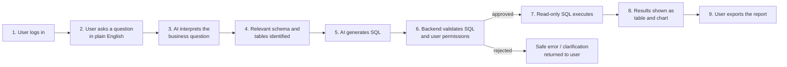

# DataTalk AI – Business and Technical Requirements

**AI-Powered Natural-Language Database Reporting**

| Item | Detail |
|------|--------|
| Document type | Business and technical requirements proposal |
| Intended audience | Company AI/ML team, solution architects, development team, business stakeholders |
| Status | Draft for evaluation |
| Prepared by | Initiative owner (independent proof of concept author) |

> **How to read this document**
> This document describes **what** the company needs and **what the expected solution must deliver**.
> It is not a project handover and not a request to reuse or rebuild any existing code.
> Items marked **[To be confirmed]** need a decision or input from the company before they can be finalised.

---

## 1. Project Introduction

### 1.1 Project name
**DataTalk AI** – AI-powered natural-language database reporting.

### 1.2 Business objective
Enable authorised business users to obtain accurate, permission-controlled reports from company databases by asking questions in plain English, without writing SQL or raising a request to a technical team.

### 1.3 Problem being addressed
Getting business data out of operational databases currently depends on people who know SQL and the database structure. Simple, repeated questions ("how many payments failed last week?") wait in the same queue as complex work.

### 1.4 Proposed solution
A secure web application where a user types a business question, an AI model translates it into a database query, the system validates the query against the user's permissions, executes it with read-only access, and presents the result as a table and chart that can be filtered, explained and exported.

---

## 2. Existing Business Problem

Today, users who need data typically depend on:

| Dependency | Typical effect |
|------------|----------------|
| **SQL knowledge** | Business users cannot query data themselves; only technically skilled staff can. |
| **Developers** | New or changed reports require development effort, testing and a release. |
| **Database / operations teams** | Ad-hoc data requests are raised as tickets and handled alongside operational work. |
| **Manual report creation** | Data is extracted, then reformatted in spreadsheets by hand, which is slow and error-prone. |
| **Repeated reporting requests** | The same or similar questions are asked repeatedly by different people, with each request handled individually. |

**Effect on turnaround time:** each request involves hand-offs (requester → analyst/developer → database → formatting → requester). Clarifying the question, prioritising it against other work and validating the result all add delay. Simple questions can therefore take much longer to answer than the query itself takes to run.

> No company-specific statistics are claimed here. The company should measure the current baseline (for example: number of ad-hoc data requests per month, average turnaround time, effort per request) so that the benefit of the solution can be evaluated objectively. **[To be confirmed]**

---

## 3. Proposed Solution

Users ask business questions in simple English and receive database-backed reports.

### 3.1 Example questions
- Show failed payments from last month.
- Show total transactions grouped by merchant.
- Compare this month's payments with last month.
- Show devices that are currently inactive.
- Show settlement details for a customer.
- Show customer-wise transaction summaries.

### 3.2 Expected workflow



1. User logs in.
2. User enters a natural-language question.
3. AI understands the business question.
4. The system identifies the relevant database schema and tables.
5. AI generates SQL.
6. The backend validates the SQL and the user's permissions.
7. Approved, read-only SQL executes.
8. Results are displayed as tables or charts.
9. The user can export the report.

---

## 4. Target Users

| Role | Description | Expected data access |
|------|-------------|----------------------|
| **ADMIN** | Platform / internal administrators | All business data across all customers; Query Analytics; user and configuration management **[To be confirmed]** |
| **BUSINESS** | Business users of a customer organisation (e.g. merchant owner, finance) | All business data belonging to **their own customer** only, including payments, devices, locations and settlements **[To be confirmed]** |
| **MANAGER** | Operational managers of a customer organisation | Data belonging to their own customer; exact scope (e.g. all locations vs. assigned locations, settlement visibility) **[To be confirmed]** |
| **CUSTOMER** | End customer / limited operator users | Restricted to explicitly assigned resources (e.g. specific devices) and a limited set of data areas such as transactions and device status; no financial settlement or customer master data **[To be confirmed]** |

General access requirements:
- A user must never see data belonging to another customer unless their role explicitly allows it.
- Role-to-data mappings must be configurable and owned by the company, not decided by the AI model.
- The final role model, role names and permission matrix must be agreed with business owners and the security team. **[To be confirmed]**

---

## 5. Functional Requirements

Priority key: **M** = Must have, **S** = Should have, **C** = Could have. Priorities are proposals. **[To be confirmed]**

### 5.1 User management

| ID | Requirement | Priority |
|----|-------------|----------|
| UM-1 | Users log in with secure credentials, or the company's identity provider (SSO), if required **[To be confirmed]**. | M |
| UM-2 | Passwords (if stored locally) are stored only as strong one-way hashes. | M |
| UM-3 | Each user has a role and, where applicable, an associated customer organisation. | M |
| UM-4 | Role-based permissions control which data areas, tables and functions a user can access. | M |
| UM-5 | Customer-level access restrictions ensure users only see their own organisation's data. | M |
| UM-6 | Resource-level restrictions (e.g. assigned devices or locations) are supported where needed. | S |
| UM-7 | Sessions expire after inactivity; users can log out. Login attempts are recorded for audit. | M |

### 5.2 AI chat

| ID | Requirement | Priority |
|----|-------------|----------|
| AC-1 | Users can ask questions in natural language through a chat interface. | M |
| AC-2 | Follow-up questions use the conversation context (e.g. "now only for last week", "group that by city"). | S |
| AC-3 | When a question is ambiguous or cannot be answered from available data, the system asks for clarification or explains why, instead of guessing. | S |
| AC-4 | Errors (AI unavailable, invalid query, permission denied, timeout) are shown as clear, non-technical messages. | M |
| AC-5 | The system shows its interpretation of the question so the user can confirm the report matches the intent. | S |

### 5.3 Database understanding

| ID | Requirement | Priority |
|----|-------------|----------|
| DU-1 | The system discovers database schemas, tables and columns automatically from metadata. | M |
| DU-2 | Column data types, keys and foreign-key relationships are understood and used to build correct joins. | M |
| DU-3 | Business terminology (e.g. "merchant", "failed payment", "inactive device") is mapped to the correct tables, columns and values. | M |
| DU-4 | Business descriptions of tables and columns are maintained as metadata and provided to the model. | S |
| DU-5 | Only metadata for data the user is allowed to access is used when answering that user's question. | M |

### 5.4 SQL generation

| ID | Requirement | Priority |
|----|-------------|----------|
| SG-1 | Natural-language questions are converted into SQL. | M |
| SG-2 | Generated SQL is compatible with the target database (PostgreSQL in the reference scenario). | M |
| SG-3 | Every generated query is validated before execution (see Section 8). | M |
| SG-4 | Only safe, read-only queries are executed. | M |
| SG-5 | Permissions are enforced by the backend, independently of the AI-generated SQL. | M |
| SG-6 | Frequently used or verified questions may reuse validated queries to save cost and time. | C |

### 5.5 Report output

| ID | Requirement | Priority |
|----|-------------|----------|
| RO-1 | Results are shown in a readable table with formatted numbers, dates and currency. | M |
| RO-2 | Suitable charts (bar, line, pie, etc.) are shown where the data allows it. | S |
| RO-3 | Users can apply simple filters (e.g. date range, status) without rewriting the question. | S |
| RO-4 | Large results are paginated. | M |
| RO-5 | A short plain-language explanation of the report is provided. | S |
| RO-6 | Reports can be exported to PDF and Excel. | M |

### 5.6 Additional functionality

| ID | Requirement | Priority |
|----|-------------|----------|
| AF-1 | **Chat history** – users can view and re-open their previous questions and results. | S |
| AF-2 | **Saved user context** – the system remembers relevant context within a conversation (and optionally user preferences). | S |
| AF-3 | **Predefined reports** – a curated catalogue of verified, commonly used reports runs without AI generation. | S |
| AF-4 | **Query Analytics** – administrators can see usage, success/failure rates, response times, popular reports and AI provider usage. | S |
| AF-5 | **Export job tracking** – large exports run in the background; their status, owner, format, timestamps, file location and errors are recorded. | S |

---

## 6. AI/ML Requirements

The AI/ML team is expected to own the following responsibilities. The choice of model and provider is intentionally left open for the team's recommendation.

| # | Responsibility | Expected outcome |
|---|----------------|------------------|
| 1 | Evaluate suitable LLMs and model providers | Comparison of candidate models (hosted and/or self-hosted) on accuracy, latency, cost, data-privacy terms and availability. |
| 2 | Recommend the best model for PostgreSQL text-to-SQL | A justified recommendation, with a fallback option. |
| 3 | Design prompts and schema context | A prompt and context strategy (e.g. schema selection, retrieval of relevant tables, examples) that scales to the real schema size. |
| 4 | Improve SQL generation accuracy | Techniques such as few-shot examples, retrieval of verified queries, self-correction from validation errors, or fine-tuning, if justified. |
| 5 | Handle ambiguous questions | A defined approach to detect ambiguity and ask clarifying questions. |
| 6 | Understand business terminology | A maintainable business glossary / semantic layer mapping business terms to data. |
| 7 | Support multi-turn questions | Conversation context handling for follow-up questions. |
| 8 | Evaluate generated SQL against expected results | An evaluation dataset of questions with expected SQL and/or expected results, plus an automated evaluation process with reported accuracy metrics. |
| 9 | Measure model response time and token usage | Monitoring of latency, token consumption and error rates per model/provider. |
| 10 | Recommend cost-effective infrastructure | Cost estimates for the expected usage, including caching and model-tiering options. |

---

## 7. Database Requirements

| ID | Requirement |
|----|-------------|
| DB-1 | **Connectivity** – secure (encrypted) connectivity from the application to the reporting database(s). |
| DB-2 | **Schema discovery** – automatic discovery of schemas, tables, columns and data types from database metadata. |
| DB-3 | **Table and column metadata** – including keys, nullability and data types. |
| DB-4 | **Foreign-key relationships** – used to understand how tables are joined. |
| DB-5 | **Business descriptions** – maintained descriptions for tables and columns (e.g. database comments or a separate metadata catalogue). |
| DB-6 | **Sample datasets for evaluation** – a representative, anonymised or synthetic dataset for development and AI evaluation. Real customer or card data must not be used for model evaluation unless approved. |
| DB-7 | **Read-only access** – reporting queries run with a dedicated read-only database account, read-only transactions and a statement timeout. |
| DB-8 | **Customer-specific restrictions** – enforcement of customer-level (and, where needed, resource-level) data isolation. Database-level controls (e.g. row-level security or secured views) should be considered. |
| DB-9 | **Replica / reporting source** – queries should preferably run against a read replica or reporting database, not the primary transactional database **[To be confirmed]**. |

> The production database platform, schema, sample data and access details **must be confirmed by the company**.
> The personal POC used a cloud-hosted PostgreSQL database with synthetic data. That database is **not** assumed to be the production database.

---

## 8. Security Requirements

| ID | Requirement |
|----|-------------|
| SEC-1 | **Read-only database access** – the reporting connection must use an account with SELECT-only privileges on approved schemas. |
| SEC-2 | **SELECT-only execution** – only single SELECT statements (including approved CTEs / `WITH` clauses) may run. INSERT, UPDATE, DELETE, DDL, multiple statements and administrative commands must be rejected. |
| SEC-3 | **SQL parser validation** – queries must be validated with a proper SQL parser (not only keyword or regex checks). |
| SEC-4 | **Allowed tables and columns** – an allow-list per role defines which tables and columns may be queried; sensitive columns are blocked. |
| SEC-5 | **Role-based access** – enforced in the backend for every request. |
| SEC-6 | **Customer-level data isolation** – the backend applies the user's customer restriction to every query, regardless of the SQL the AI produces. |
| SEC-7 | **Device/resource-level restrictions** – applied where the role requires it (e.g. users limited to assigned devices). |
| SEC-8 | **Query timeout** – every query has a maximum execution time. |
| SEC-9 | **Maximum row limits** – result sizes are capped for display and for export. |
| SEC-10 | **Secure credential management** – database passwords and AI API keys are stored in a secrets manager or secure environment configuration, never in source code or documentation, and are rotated regularly. |
| SEC-11 | **Data minimisation for AI providers** – only the information needed to generate SQL (e.g. schema metadata and the question) is sent to external AI providers. Customer records, payment data and query results should not be sent unless explicitly approved. |
| SEC-12 | **Audit trail** – questions, generated SQL, validation outcome, executing user and timestamps are logged for audit. |
| SEC-13 | **Prompt-injection resilience** – user input must not be able to override security rules; security is enforced outside the model. |
| SEC-14 | **Compliance** – the solution must meet the company's applicable data-protection and payment-industry obligations (e.g. PCI DSS for card data). **[To be confirmed]** |

> **Key principle:** AI-generated SQL must **never** independently decide user permissions. The AI only proposes a query. The backend decides whether the query is allowed and applies the user's data restrictions before execution.

---

## 9. Technical Architecture Requirements

The expected high-level architecture is described in technology-independent terms.

| Component | Responsibility |
|-----------|----------------|
| **Web application** | Login, chat interface, result tables/charts, filters, exports, history, admin analytics. |
| **Backend application** | Authentication, session/token handling, authorisation, orchestration of the question-to-report flow, APIs. |
| **AI/LLM integration layer** | Provider-agnostic access to one or more models, prompt assembly, retries/fallback, timeouts, usage tracking. |
| **Database metadata / schema service** | Discovers and caches schemas, relationships and business descriptions; supplies permission-filtered context to the AI layer. |
| **SQL validation and execution service** | Parses and validates SQL, applies role and customer restrictions, executes read-only with timeouts and row limits. |
| **Reporting service** | Formats results, pagination, filters, chart selection, explanations, predefined report catalogue. |
| **Export service** | PDF/Excel generation, background jobs for large exports, job tracking and file retention. |
| **Analytics and monitoring** | Usage analytics, accuracy and failure tracking, latency, token usage and cost, operational logs and alerts. |

```mermaid
flowchart TB
    U[Business user<br/>browser] --> WEB[Web application]
    WEB --> API[Backend application<br/>auth, authorisation, orchestration]

    API --> AI[AI / LLM integration layer]
    AI --> LLM[(LLM provider(s)<br/>hosted or self-hosted)]
    API --> META[Database metadata /<br/>schema service]
    AI -. permission-filtered<br/>schema context .-> META

    API --> VAL[SQL validation and<br/>execution service]
    VAL --> RO[(Reporting database<br/>read-only account / replica)]
    META --> RO

    API --> REP[Reporting service<br/>tables, charts, filters, pagination]
    API --> EXP[Export service<br/>PDF / Excel, background jobs]
    EXP --> FS[(Export file storage)]

    API --> APPDB[(Application database<br/>users, chat history, export jobs, analytics)]
    API --> MON[Analytics and monitoring]
    AI --> MON
    VAL --> MON
```

Technology notes:
- The personal POC used **Java / Spring Boot** for the backend and **PostgreSQL** as the database. These are possible choices, **not mandatory decisions**, unless the company confirms them. **[To be confirmed]**
- The architecture should allow the LLM provider to be changed without redesigning the application.
- Deployment model (cloud, on-premises, hybrid) and hosting platform. **[To be confirmed]**

---

## 10. UI/UX Requirements

| Area | Requirement |
|------|-------------|
| **Login** | Simple, secure login page; SSO integration if required **[To be confirmed]**. |
| **Dashboard** | Welcome page with the user's identity, role, organisation and a short data summary appropriate to the role. |
| **Natural-language chat** | Question input, conversation view, loading indicator, suggested/example questions. |
| **Report result table** | Sortable, readable table with consistent number, date and currency formatting. |
| **Charts** | Automatic chart suggestion with the option to switch chart type or view the table only. |
| **Filters and pagination** | Quick filters (e.g. date range, status) and paging for large results. |
| **SQL details** | Generated SQL visible only to authorised roles (e.g. administrators/analysts), if required **[To be confirmed]**. |
| **Export controls** | Export to PDF and Excel; progress/status display for large background exports. |
| **Chat history** | List of previous questions and conversations; ability to re-open results. |
| **Query Analytics** | Administrator-only page showing usage and quality metrics. |
| **Accessibility and branding** | Company UI standards, accessibility guidelines and responsive layout **[To be confirmed]**. |

---

## 11. API and Integration Requirements

The solution should expose APIs that support the following capabilities. The official API design (style, paths, versioning, authentication method) is to be **proposed by the company development team**. The POC's endpoints are not intended as mandatory production APIs.

| Capability | Description |
|------------|-------------|
| Authentication | Log in / log out, current user information, token or session management, SSO integration if required. |
| Chat / question submission | Submit a question with optional conversation context; receive interpretation, status and report reference. |
| Query / report generation | Generate and validate SQL, execute it, return results and metadata; run predefined reports with parameters. |
| Report result retrieval | Retrieve paginated and filtered results for a previously generated report. |
| Chat history | List and retrieve previous questions and conversations for the current user. |
| Export generation and download | Request PDF/Excel export, track background export jobs, download completed files securely (owner only). |
| Query Analytics | Administrator-only retrieval of usage, quality, latency and provider metrics. |
| Integrations | Identity provider, monitoring/logging platform, secrets manager, and possibly existing reporting tools **[To be confirmed]**. |

---

## 12. Non-Functional Requirements

Numeric targets are intentionally not set here. They must be agreed with the company. **[To be confirmed]**

| Category | Requirement |
|----------|-------------|
| **Performance** | Interactive response times acceptable to business users for typical questions; target end-to-end response time and query time limits **[To be confirmed]**. |
| **Scalability** | Support the expected number of users and concurrent questions; horizontal scaling of stateless components; background export processing that scales independently **[To be confirmed]**. |
| **Reliability** | Graceful handling of AI provider failures (retry/fallback), database timeouts and partial failures; no data corruption risk (read-only). |
| **Security** | Requirements in Section 8; regular security testing and review. |
| **Maintainability** | Modular design; prompts, business glossary, role permissions and predefined reports maintainable without major code changes. |
| **Logging and monitoring** | Structured logs, audit trail, metrics for latency, errors, accuracy and token usage, alerting. |
| **Model provider flexibility** | Ability to switch or combine LLM providers/models through configuration. |
| **Cost control** | Visibility of AI usage cost; limits/quotas per user or tenant; caching of verified queries where safe. |
| **Availability** | Target availability and support hours **[To be confirmed]**. |
| **Data retention** | Retention periods for chat history, audit logs and export files **[To be confirmed]**. |

---

## 13. Expected Deliverables

From the company AI/ML and development teams:

1. Recommended AI model(s), provider strategy and overall solution architecture.
2. Validated database integration approach (connectivity, metadata, read-only access, data isolation).
3. Natural-language-to-SQL solution, including prompt/context design and ambiguity handling.
4. SQL security and authorisation implementation (validation, allow-lists, customer/resource isolation).
5. Reporting user interface (chat, results, history, administration).
6. Charts and PDF/Excel exports, including background export tracking.
7. Testing and evaluation results (functional, security, and SQL accuracy against an agreed evaluation set).
8. Deployment approach (environments, CI/CD, configuration and secrets management).
9. Documentation (architecture, operations, user guide, administration guide).
10. Cost and infrastructure estimates (AI usage, hosting, operations).

---

## 14. POC Reference

An **independent working proof of concept** has been developed to demonstrate that the idea is feasible. It uses a synthetic dataset for a cashless-payment and device-management business: customers, locations, devices, device events, payment transactions and settlements.

The following features have been implemented and verified in the POC:

| Area | What the POC demonstrates |
|------|---------------------------|
| Backend | Java 17 / Spring Boot 3 web application with server-rendered pages and JSON APIs. |
| Database | Cloud-hosted Neon PostgreSQL with six schemas, synthetic sample data and a read-only reporting role definition. |
| AI providers | Integration with **Gemini**, **NVIDIA** (OpenAI-compatible API) and **Groq**, with a configurable primary provider and automatic fallback; the UI shows which provider/model answered. |
| Schema-aware SQL generation | Database metadata, filtered by the user's role, is supplied to the model to generate PostgreSQL queries. |
| SQL safety validation | Parser-based validation that allows only SELECT queries (with CTEs), restricts tables per role, blocks sensitive columns and enforces timeouts and row limits. |
| Access restrictions | Role-based access (ADMIN, BUSINESS, MANAGER, CUSTOMER) with customer-level isolation and device-level restriction for the CUSTOMER role, enforced by the backend. |
| Chat history and context | Questions, generated SQL, status and results are stored; conversations support follow-up questions using saved context. |
| Predefined reports | A catalogue of verified SQL reports (payments, devices, settlements, customers) that run without AI generation. |
| Report output | Tables, charts, date/status filters and pagination. |
| Export | PDF and Excel export, with background processing for large exports and export job tracking. |
| Query Analytics | Basic administrator-only page: question counts, success/failure, approximate response times, popular reports and AI provider usage. |

> **Important:** the POC is a reference for understanding the concept and its feasibility. It is **not** a mandatory production architecture or codebase. The company team is expected to design and build the official solution according to company standards. The POC has not been load-tested, security-certified or evaluated against a formal SQL-accuracy benchmark.

---

## 15. Future Enhancements

Possible features after the initial release (not part of the core scope unless agreed):

- **Scheduled reports** – recurring delivery of reports by email or other channels.
- **Saved reports** – users save and share questions/reports and pin them to a dashboard.
- **Advanced business insights** – automatic trend, anomaly and outlier detection with narrative summaries.
- **Intelligent follow-up questions** – suggested next questions based on the current result.
- **More database integrations** – additional databases, data warehouses or data sources.
- **Advanced analytics** – drill-down, cross-report comparison, forecasting.
- **Improved AI evaluation and optimisation** – continuous accuracy benchmarking, user feedback loops, model tuning, cost/latency optimisation.

---

## 16. Open Questions for the AI/ML Team

1. Which LLM (or combination of models) is best suited for this use case, in terms of SQL accuracy, latency and cost?
2. Should the solution use a hosted model, a self-hosted model, or a hybrid approach, given data-privacy requirements?
3. How should database schemas and business metadata be shared with the model (full schema, retrieval of relevant tables, semantic layer)?
4. How can SQL accuracy be evaluated reliably (evaluation dataset, execution-result comparison, human review)?
5. How should complex joins, business terminology and company-specific definitions (e.g. "active merchant", "failed payment") be handled?
6. How should ambiguous questions and multi-turn conversations be handled?
7. What is the recommended overall architecture and how should it integrate with existing company systems?
8. What are the expected infrastructure and operational costs at the anticipated usage?
9. What security controls are required for production (data sent to AI providers, prompt injection, auditing, compliance)?
10. Should database-level controls (e.g. row-level security, secured views) complement the application-level validation?
11. What monitoring is needed to detect degraded accuracy or unexpected model behaviour over time?

### Questions for the business / company **[To be confirmed]**
- Which databases and schemas are in scope for the first release?
- What is the final role model and permission matrix?
- What are the target users, expected usage volumes and performance expectations?
- What compliance and data-residency constraints apply?
