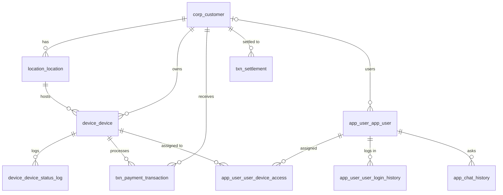

# SL Talk AI – POC Requirements and Database Specification

| Item | Detail |
|------|--------|
| Document type | Requirements for building a **proof of concept (POC)** |
| Prepared by | Vijay – Built by Vijay \| SL Talk AI |
| Audience | Company AI/ML and development teams |
| Scope | POC level only – not a production specification |
| Related document | `DATATALK_AI_BUSINESS_AND_TECHNICAL_REQUIREMENTS.md` (full business and technical proposal) |
| Status | Draft for discussion. Items marked **[To be confirmed]** need a company decision. |

> This document describes **what** the POC must do and the **database** it should work against.
> It does not prescribe a programming language, framework or AI model. An independent reference POC
> exists (Java/Spring Boot + PostgreSQL) and can be demonstrated, but it is not a mandatory design.

---

## 1. Concept in One Paragraph

Business users should be able to type a question in plain English – for example *"Show failed payments
from last month by location"* – and receive a report built from live database data. An AI model converts
the question into a PostgreSQL `SELECT` query. The backend validates the query, applies the user's data
permissions, runs it with read-only access and shows the result as a table or chart that can be exported.

## 2. POC Objectives

The POC must prove that:

1. An LLM can turn typical business questions into **correct PostgreSQL SQL** for the given schema.
2. Generated SQL can be **validated and restricted** so users only see data they are allowed to see.
3. The end-to-end flow (question → SQL → result → table/chart → export) is usable by non-technical users.
4. Response time, accuracy and AI cost are acceptable enough to justify a production project.

## 3. POC Scope

### 3.1 In scope

| # | Capability | Priority |
|---|------------|----------|
| S1 | Login with username/password and role-based access | Must |
| S2 | Natural-language question → AI-generated PostgreSQL `SELECT` | Must |
| S3 | SQL safety validation and read-only execution | Must |
| S4 | Customer-level data isolation (and device-level for CUSTOMER role) | Must |
| S5 | Result table with pagination | Must |
| S6 | Simple charts (bar, line, pie) where the data suits it | Should |
| S7 | Short explanation of what the report shows | Should |
| S8 | Chat history per user | Should |
| S9 | Follow-up questions using the previous question as context | Should |
| S10 | Predefined (ready-made) reports for common questions | Should |
| S11 | Export to PDF and Excel | Should |
| S12 | Basic query analytics for administrators (success/failure counts, response time, model used) | Could |
| S13 | Configurable AI provider/model with fallback | Could |

### 3.2 Out of scope for the POC

- Production deployment, high availability and scaling.
- Single sign-on / company identity integration **[To be confirmed]**.
- Scheduled or emailed reports, saved report library, dashboards builder.
- Write operations of any kind on business data.
- Connecting to production data – the POC uses the sample database in section 8.

## 4. Users and Roles

| Role | Who | Data access in the POC |
|------|-----|------------------------|
| ADMIN | Internal administrators | All customers, all business tables, query analytics |
| BUSINESS | Internal business / sales users | Business tables for their assigned customer **[To be confirmed: all customers?]** |
| MANAGER | Customer-side or internal managers | Business tables for their assigned customer |
| CUSTOMER | Merchant users | Only their own customer's transactions, devices, device events and locations; only devices assigned to them |

Rules:

- Role, customer and status must be read from the database on the server side – never from the AI or the browser.
- Inactive users must not be able to log in or run reports.
- Exact role permissions for production are **[To be confirmed]** by the business.

## 5. Functional Requirements

### 5.1 Authentication and session

| ID | Requirement |
|----|-------------|
| FR-1 | Users log in with username and password; passwords are stored only as BCrypt (or stronger) hashes. |
| FR-2 | A server-side session holds the user id; logout ends the session. |
| FR-3 | Login and logout events are recorded in `app_user.user_login_history`. |
| FR-4 | After login the user sees their name, role and customer. |

### 5.2 AI question → SQL

| ID | Requirement |
|----|-------------|
| FR-5 | User enters a question in plain English. |
| FR-6 | The system sends the AI model the question plus a **schema description** (approved tables, columns, data types, relationships, column comments and allowed status values). |
| FR-7 | The AI returns a structured answer: SQL, report title, short explanation and suggested chart type. |
| FR-8 | If the question cannot be answered from the data, the AI must say so instead of inventing SQL. |
| FR-9 | Follow-up questions (e.g. *"now only for Visa"*) use the previous question/SQL as context. |
| FR-10 | No result rows, passwords or card data are sent to the AI provider. |

### 5.3 SQL validation and execution

| ID | Requirement |
|----|-------------|
| FR-11 | Only a single `SELECT` statement is allowed (CTEs allowed). Reject `INSERT`, `UPDATE`, `DELETE`, DDL, `GRANT`, multiple statements, `SELECT INTO`, `FOR UPDATE`. |
| FR-12 | Use a SQL parser (not only text matching) to check every table and column against an allow-list. |
| FR-13 | Block system schemas (`pg_catalog`, `information_schema`, …) and application schemas (`app`, `app_user`). |
| FR-14 | Block sensitive columns: `corp.customer.email`, `corp.customer.phone`, `txn.payment_transaction.card_last_four`. |
| FR-15 | The backend – not the AI – adds customer and device filters based on the logged-in user. |
| FR-16 | Queries run in a read-only transaction under a read-only database role with a statement timeout (POC value: 30 s). |
| FR-17 | Results are paginated (POC values: 25 rows per page, max 100). |
| FR-18 | Each question is stored in chat history with status, generated SQL, model used, error message and duration. |

### 5.4 Report output

| ID | Requirement |
|----|-------------|
| FR-19 | Show results as a table with column headers and pagination. |
| FR-20 | Show a chart when the result has a category/date column and a numeric column. |
| FR-21 | Show the report title and explanation; show generated SQL to authorized users **[To be confirmed: which roles]**. |
| FR-22 | Allow simple filters (date range, transaction status). |
| FR-23 | Export the full result to PDF and Excel, with a row limit (POC value: 50,000). Exports apply the same permissions. |

### 5.5 Predefined reports and analytics

| ID | Requirement |
|----|-------------|
| FR-24 | Provide ready-made reports (examples in section 9) that run through the same validation and permissions. |
| FR-25 | Admin-only analytics page: total / successful / failed questions, average response time, popular reports, AI model usage. |

## 6. AI/ML Requirements for the POC

The AI/ML team is asked to:

1. Select one or more LLMs suitable for PostgreSQL text-to-SQL and justify the choice (accuracy, latency, cost, data privacy).
2. Design the prompt and the way the schema is supplied to the model (full schema vs. relevant tables only).
3. Build a small **evaluation set** of business questions with expected SQL/results (see section 10) and report accuracy.
4. Measure response time and token usage per question.
5. Handle ambiguous questions (ask for clarification or state assumptions).
6. Map business terms to columns, for example:

| Business term | Database meaning |
|---------------|------------------|
| Sales, revenue, payments | `txn.payment_transaction.amount` where `transaction_status = 'APPROVED'` |
| Failed / declined payments | `transaction_status IN ('DECLINED','FAILED')` |
| Merchant | `corp.customer` |
| Store, branch, site | `location.location` |
| Terminal, device, reader | `device.device` |
| Offline / inactive device | `device.status <> 'ACTIVE'` or old `last_communication_time` |
| Payout, settlement | `txn.settlement` (`net_amount` = total − fees) |

The model choice is open. The reference POC was tested with hosted models from Groq, Google Gemini and NVIDIA
through their APIs; this is only for information.

## 7. Non-Functional Requirements (POC level)

| Area | POC requirement |
|------|-----------------|
| Security | No credentials in source code; secrets come from environment variables or a secret store. |
| Data privacy | Only schema metadata and the question go to the AI provider; no result data or card data. |
| Performance | Measure and report response time; targets **[To be confirmed]**. |
| Reliability | Clear error messages when the AI or database fails; no partial or unfiltered data shown. |
| Cost | Report token usage and estimated cost per question. |
| Maintainability | AI provider and model must be configurable without code changes. |
| Logging | Log questions, SQL, outcome and duration; never log passwords or API keys. |

---

## 8. Database Specification

### 8.1 Database platform

| Item | Detail |
|------|--------|
| Engine | PostgreSQL – Neon serverless PostgreSQL (AWS `ap-southeast-1`, Singapore) |
| Host | `ep-lingering-brook-b3tgnze7-pooler.c-4.ap-southeast-1.aws.neon.tech` (connection pooler) |
| Port / database | `5432` / `neondb` |
| JDBC URL | `jdbc:postgresql://ep-lingering-brook-b3tgnze7-pooler.c-4.ap-southeast-1.aws.neon.tech:5432/neondb?sslmode=require` |
| URI (psql / Python) | `postgresql://<username>@ep-lingering-brook-b3tgnze7-pooler.c-4.ap-southeast-1.aws.neon.tech/neondb?sslmode=require` |
| SSL | Required (`sslmode=require`) |
| Usernames | `user_datatalk` (application account); `datatalk_ro` (read-only reporting role). Team members should receive a **read-only** login. |
| Credentials | Passwords are not included in this document. Authorized team members obtain them from the project owner through a secure channel. |
| Configuration variables | `DB_URL`, `DB_USER`, `DB_PASSWORD`, `REPORT_DB_ROLE` (read-only role, default `datatalk_ro`) |
| Production database | **[To be confirmed]** – the company must provide the real schema, data and access. The POC database is sample data only. |

### 8.2 Schemas

| Schema | Purpose | Available to AI reports |
|--------|---------|-------------------------|
| `corp` | Customers (merchants) | Yes |
| `location` | Customer locations / branches | Yes |
| `device` | Payment devices and device events | Yes |
| `txn` | Payment transactions and settlements | Yes |
| `app_user` | Users, login history, device assignments | **No** |
| `app` | Application data: chat history, AI context, export jobs | **No** |

### 8.3 Business tables (used for reporting)

**`corp.customer`** – merchant master data

| Column | Type | Notes |
|--------|------|-------|
| `customer_id` | SERIAL | PK |
| `customer_name` | VARCHAR(255) | NOT NULL |
| `email` | VARCHAR(255) | UNIQUE – **blocked from reports** |
| `phone` | VARCHAR(20) | **blocked from reports** |
| `status` | VARCHAR(50) | `ACTIVE`, `INACTIVE`, `SUSPENDED`, `ARCHIVED` |
| `created_date` | TIMESTAMP | |
| `updated_date` | TIMESTAMP | |

**`location.location`** – customer branches

| Column | Type | Notes |
|--------|------|-------|
| `location_id` | SERIAL | PK |
| `customer_id` | INTEGER | FK → `corp.customer` |
| `location_name` | VARCHAR(255) | |
| `city`, `state` | VARCHAR(100) | |
| `timezone` | VARCHAR(50) | default `UTC` |
| `created_date` | TIMESTAMP | |

**`device.device`** – payment devices

| Column | Type | Notes |
|--------|------|-------|
| `device_id` | SERIAL | PK |
| `serial_number` | VARCHAR(100) | UNIQUE |
| `customer_id` | INTEGER | FK → `corp.customer` |
| `location_id` | INTEGER | FK → `location.location` |
| `device_type` | VARCHAR(50) | `POS_TERMINAL`, `MOBILE_READER`, `PAYMENT_GATEWAY`, `ATM` |
| `firmware_version` | VARCHAR(50) | |
| `status` | VARCHAR(50) | `ACTIVE`, `INACTIVE`, `MAINTENANCE`, `DECOMMISSIONED`, `ERROR` |
| `activated_date` | TIMESTAMP | |
| `last_communication_time` | TIMESTAMP | |
| `created_date` | TIMESTAMP | |

**`device.device_status_log`** – device events

| Column | Type | Notes |
|--------|------|-------|
| `event_id` | SERIAL | PK |
| `device_id` | INTEGER | FK → `device.device` |
| `event_type` | VARCHAR(50) | `ACTIVATED`, `DEACTIVATED`, `HEARTBEAT`, `ERROR`, `MAINTENANCE`, `COMMUNICATION_LOST` |
| `event_time` | TIMESTAMP | |
| `description` | TEXT | |
| `created_date` | TIMESTAMP | |

**`txn.payment_transaction`** – card payments

| Column | Type | Notes |
|--------|------|-------|
| `transaction_id` | SERIAL | PK |
| `device_id` | INTEGER | FK → `device.device` |
| `customer_id` | INTEGER | FK → `corp.customer` |
| `amount` | DECIMAL(15,2) | |
| `card_type` | VARCHAR(50) | `VISA`, `MASTERCARD`, `AMEX`, `DISCOVER`, `DEBIT`, `PREPAID`, `OTHER` |
| `entry_mode` | VARCHAR(50) | `SWIPE`, `INSERT`, `TAP`, `ONLINE`, `MANUAL`, `QR` |
| `transaction_status` | VARCHAR(50) | `APPROVED`, `DECLINED`, `PENDING`, `REFUNDED`, `FAILED`, `CANCELLED` |
| `decline_reason` | VARCHAR(255) | |
| `card_last_four` | VARCHAR(4) | **blocked from reports** |
| `transaction_time` | TIMESTAMP | |
| `created_date` | TIMESTAMP | |

**`txn.settlement`** – daily settlements per customer

| Column | Type | Notes |
|--------|------|-------|
| `settlement_id` | SERIAL | PK |
| `customer_id` | INTEGER | FK → `corp.customer` |
| `settlement_date` | DATE | |
| `total_amount` | DECIMAL(15,2) | |
| `fees` | DECIMAL(15,2) | default 0 |
| `net_amount` | DECIMAL(15,2) | |
| `status` | VARCHAR(50) | `PENDING`, `PROCESSING`, `COMPLETED`, `FAILED`, `CANCELLED` |
| `created_date` | TIMESTAMP | |

### 8.4 User and application tables (not reportable)

| Table | Key columns | Purpose |
|-------|-------------|---------|
| `app_user.app_user` | `user_id` PK, `username` UNIQUE, `password_hash`, `full_name`, `email`, `role` (`ADMIN`/`BUSINESS`/`MANAGER`/`CUSTOMER`), `customer_id` FK (NULL for ADMIN), `status` (`ACTIVE`/`INACTIVE`/`LOCKED`/`PENDING`) | Users and roles |
| `app_user.user_login_history` | `login_id` PK, `user_id` FK, `login_time`, `logout_time`, `ip_address`, `status`, `failure_reason`, `channel` | Login audit |
| `app_user.user_device_access` | PK (`user_id`, `device_id`), both FK | Devices a user may see |
| `app.chat_history` | `chat_id` PK, `user_id` FK, `user_question`, `generated_sql`, `query_status`, `created_at`, plus `conversation_id`, `report_title`, `explanation`, `chart_type`, `row_count`, `error_message`, `ai_provider`, `source`, `duration_ms` | Question history and analytics |
| `app.user_ai_context` | `user_id` PK/FK, `context` JSONB, `updated_at` | Short conversation context per user |
| `app.export_job` | `job_id` PK, `user_id` FK, `chat_id` FK, `report_name`, `export_format`, `job_status`, `created_date`, `completed_date`, `file_location`, `error_message` | Export tracking |

### 8.5 Relationships

Common joins:

- Transactions by location: `txn.payment_transaction` → `device.device` (`device_id`) → `location.location` (`location_id`)
- Transactions by merchant: `txn.payment_transaction` → `corp.customer` (`customer_id`)
- Device events by location: `device.device_status_log` → `device.device` → `location.location`

### 8.6 Sample data (synthetic – no real customer or card data)

| Table | Rows | Notes |
|-------|------|-------|
| `corp.customer` | 5 | Fictional merchants |
| `location.location` | 15 | US cities and time zones |
| `device.device` | 60 | Mostly ACTIVE, some INACTIVE/MAINTENANCE |
| `device.device_status_log` | 1,500 | Last 120 days |
| `txn.payment_transaction` | 10,000 | Last 120 days; ≈85 % APPROVED, ≈15 % DECLINED/FAILED/REFUNDED |
| `txn.settlement` | ≈600 | One per customer per day with approved transactions; fees 2.5 % |
| `app_user.app_user` | 6 | One per role; demo passwords shared separately |
| `app_user.user_login_history` | 800 | |
| `app_user.user_device_access` | ≈50 | |

### 8.7 Read-only reporting role

A dedicated role `datatalk_ro` is used for all report queries:

- `USAGE` + `SELECT` only on `corp`, `location`, `device`, `txn`.
- No access to `app` or `app_user`.
- `default_transaction_read_only = on`, `statement_timeout = 30s`.
- The application account switches to this role per report transaction (`SET LOCAL ROLE datatalk_ro`).

### 8.8 Setup scripts (run in order as database owner)

| # | Script | Purpose |
|---|--------|---------|
| 1 | `database/neon-schema.sql` | Schemas, tables, indexes, comments, views |
| 2 | `database/sample-data.sql` | Synthetic sample data |
| 3 | `database/permissions.sql` | Read-only role `datatalk_ro` |
| 4 | `database/phase2-migration.sql` | Chat history columns, AI context table, role hardening |
| 5 | `database/phase3-migration.sql` | Export job table |

The scripts can be shared with the team on request. Full column-level detail is in `DATABASE_DESIGN.md`.

---

## 9. Example Questions and Expected Reports

| Question | Tables involved |
|----------|-----------------|
| Show failed payments from last month by location | payment_transaction, device, location |
| Show total sales by card type | payment_transaction |
| Compare this month's payments with last month | payment_transaction |
| Show the top decline reasons | payment_transaction |
| Show daily sales trend for the last 30 days | payment_transaction |
| Show devices that are currently inactive | device, location |
| Show device error events this week | device_status_log, device |
| Show settlement summary for last month | settlement |
| Show revenue by customer | payment_transaction, customer |
| How many devices does each location have? | location, device |

Expected behaviour by role (examples): a BUSINESS or MANAGER user asking *"Show revenue by customer"* must only
see their own customer; a CUSTOMER user asking *"Show settlement summary"* must be refused because settlements
and customer tables are not available to that role; an ADMIN sees all customers.

## 10. POC Acceptance Criteria

| # | Criterion |
|---|-----------|
| AC-1 | Users of all four roles can log in and log out. |
| AC-2 | At least the questions in section 9 return correct results (checked against hand-written SQL). **[Target accuracy to be confirmed]** |
| AC-3 | Any non-SELECT SQL, blocked table or blocked column is rejected, even if the AI generates it. |
| AC-4 | A CUSTOMER/MANAGER/BUSINESS user can never see another customer's data, verified by test questions that try to. |
| AC-5 | Queries run read-only with a timeout; a long query is cancelled. |
| AC-6 | Results show as a table with pagination and as a chart where suitable. |
| AC-7 | PDF and Excel exports contain the same data the user is allowed to see. |
| AC-8 | Chat history shows the user's own questions only. |
| AC-9 | Response time, token usage and model used are recorded for each question. |
| AC-10 | No passwords, API keys or card data appear in code, logs, prompts or the UI. |

## 11. Expected POC Deliverables

1. Recommended LLM(s) with a short comparison (accuracy, latency, cost, privacy).
2. Working POC application covering the "Must" and "Should" items in section 3.1.
3. Evaluation results for the question set (accuracy, response time, token usage).
4. Description of the SQL security and permission approach.
5. Estimated infrastructure and AI cost for a production version.
6. Recommendation and plan for the production phase.

## 12. Open Questions

- Which LLM and hosting option (hosted API vs. self-hosted) is acceptable for company data?
- Which production database, schemas and sample data will be provided?
- What are the exact data permissions for BUSINESS and MANAGER roles?
- Should generated SQL be visible to end users?
- What accuracy and response-time targets must the POC meet?
- Will login use company single sign-on in production?
