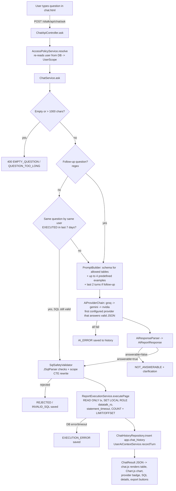

# SL Talk AI POC – Implementation Details

These are technical notes about the code as it is now. Everything below comes from reading the source in `src/main/java/com/datatalk/datatalkai/**`, `application.properties`, the templates, `static/js/chat.js`, `database/*.sql` and `src/test/**`. Nothing was confirmed by running the application.

> No secrets are recorded here. Configuration values are given only as **environment variable names**.

---

## 1. Application architecture

The application is a single Spring Boot application (`DataTalkAiApplication`). Server-rendered Thymeleaf pages call JSON REST APIs. All database access goes through Spring JDBC (`JdbcTemplate`) on a HikariCP pool. JPA is not used.

### 1.1 Packages and layers

| Package | Layer | Main classes | Responsibility |
|---|---|---|---|
| `com.datatalk.datatalkai` | Bootstrap | `DataTalkAiApplication` | Starts the application and defines the `BCryptPasswordEncoder` bean. |
| `security` | Security | `SecurityConfig` | URL rules, CSRF, a 401 entry point for `/api/**`, logout, session concurrency. |
| `controller` | Web/API | `AuthApiController`, `ChatApiController`, `ReportApiController`, `ExportApiController`, `DashboardApiController`, `AnalyticsApiController`, `PageController`, `ApiExceptionHandler` | REST endpoints, page routing and error mapping. |
| `service` | Phase 1 services | `AuthenticationService`, `DashboardService` | Login/logout and dashboard KPIs. |
| `repository` | Phase 1 data access | `UserRepository`, `CustomerRepository` | Users, login history, customer and dashboard summary queries. |
| `model`, `model.dto` | Model | `User`, `Customer`, `ApiResponse`, `LoginRequest`, `UserInfoResponse` | Domain objects and API envelopes. |
| `ai` | AI integration | `AiProvider`, `OpenAiCompatibleProvider`, `GeminiProvider`, `AiProviderConfig`, `AiProviderChain`, `PromptBuilder`, `AiResponseParser`, `AiReportResponse`, `AiHttpClients`, `AiException` | Prompt building, provider calls, fallback chain and JSON parsing. |
| `chat` | Orchestration | `ChatService`, `ChatHistoryRepository`, `UserAiContextService`, `ChatResult`, `ChatRecord`, `ChatStatus` | Runs the question → SQL → validate → execute → history flow. Also holds per-user context. |
| `reporting` | Data security & execution | `AccessPolicyService`, `UserScope`, `SchemaMetadataService`, `ReportingCatalog`, `SqlSafetyValidator`, `SecureQuery`, `ReportExecutionService`, `ReportFilters`, `ReportPage`, `ReportingConfig`, exceptions | Role scope, schema catalog, SQL validation and rewriting, read-only execution. |
| `reports` | Predefined reports | `PredefinedReportService`, `PredefinedReport` | Loads `classpath:predefined-reports/**/*.sql`. These run as reports and also serve as AI examples. |
| `export` | Export | `ReportExportService`, `ExportJobService`, `ExportJobRepository`, `ExportFormat` | PDF/Excel generation, direct and background exports, job persistence. |
| `analytics` | Admin analytics | `QueryAnalyticsService` | Metrics from `app.chat_history` and `app.export_job`. |

> The code has no package named `config`. Configuration classes live in their feature packages: `AiProviderConfig` in `ai`, `ReportingConfig` in `reporting`, and `SecurityConfig` in `security`.

### 1.2 Ask-question flow



---

## 2. Technologies and versions

| Area | Technology | Version / source |
|---|---|---|
| Language | Java | 17 (`java.version`, compiler plugin 3.11.0) |
| Framework | Spring Boot (parent) | **3.2.0** |
| Web | spring-boot-starter-web | managed by Boot 3.2.0 |
| Data access | spring-boot-starter-jdbc (JdbcTemplate, HikariCP) | managed by Boot |
| Security | spring-boot-starter-security, spring-security-crypto (BCrypt), thymeleaf-extras-springsecurity6 | managed by Boot |
| Views | spring-boot-starter-thymeleaf | managed by Boot |
| DB driver | org.postgresql:postgresql | **42.7.4** (runtime) |
| SQL parsing | com.github.jsqlparser:jsqlparser | **4.9** |
| PDF export | com.github.librepdf:openpdf | **1.3.43** |
| Excel export | org.apache.poi:poi-ooxml (SXSSF streaming) | **5.2.5** |
| JSON | jackson-databind | managed by Boot |
| Boilerplate | Lombok | managed by Boot (optional) |
| Testing | spring-boot-starter-test, spring-security-test | managed by Boot |
| AI HTTP | `java.net.http.HttpClient` (JDK), no AI SDK | — |
| Frontend CSS/JS | Bootstrap (CDN jsDelivr) | **5.3.0** |
| Icons | Font Awesome (CDN cdnjs) | **6.4.0** |
| Charts | Chart.js (CDN jsDelivr, `chart.umd.min.js`, chat page only) | **4.4.1** |
| Frontend code | Vanilla JS (`static/js/chat.js`, inline scripts in the templates) | — |
| Database | Neon PostgreSQL (managed) | Server version is not set in the code. The `phase2-migration.sql` comment says Neon runs PostgreSQL 16–18 |
| Build | Maven, spring-boot-maven-plugin | — |

---

## 3. Login and authentication flow

1. **Login page.** `login.html` sends `POST /sltalk/api/login` with JSON `{username, password}`. On success it redirects to `/sltalk/home` (central Application / Report search).
2. **Input check.** `AuthApiController.login` returns 400 `INVALID_USERNAME` or `INVALID_PASSWORD` when a field is empty.
3. **Authentication.** `AuthenticationService.authenticate`:
   - Looks up the user with `UserRepository.findByUsername`, which only returns users with `status = 'ACTIVE'`.
   - Verifies the password with `PasswordEncoder.matches`, using the `BCryptPasswordEncoder` bean.
   - Writes every attempt to `app_user.user_login_history` with `channel = 'WEB'`, the client IP (`X-Forwarded-For` → `X-Real-IP` → remote address) and a status:
     - `FAILED`: "User not found or inactive" (logged with `user_id = 0`) or "Invalid password".
     - `INACTIVE_USER`.
     - `SUCCESS`.
   - Adds `customerName` from `corp.customer` when the user belongs to a customer.
4. **Failure.** The response is 400 `INVALID_CREDENTIALS`, with the same message for a wrong username or a wrong password.
5. **Success:**
   - `request.changeSessionId()` prevents session fixation.
   - An empty `SecurityContext` is created with a `UsernamePasswordAuthenticationToken(username, null, [ROLE_<role>])`. It is set on `SecurityContextHolder` and saved with `HttpSessionSecurityContextRepository`, so Spring Security treats the session as authenticated.
   - Session attributes set: `userId`, `username`, `role`, `customerId` and `userInfo` (a `UserInfoResponse`).
   - The response is `ApiResponse.success(userInfo, "Login successful")`.
6. **Session settings** (`application.properties` / `SecurityConfig`):
   - HTTP-only cookie, `secure=false`, 30-minute timeout.
   - At most 1 concurrent session per user (expired URL `/login?expired=true`).
7. **Current user.** `GET /api/user-info` reloads the user from the DB by the `userId` session attribute.
8. **Logout:**
   - The UI calls `POST /api/logout`. `AuthApiController.logout` sets `logout_time` on the latest open `SUCCESS` row in `user_login_history`, clears the `SecurityContextHolder` and invalidates the session.
   - `SecurityConfig` also configures Spring's own logout at `/logout`, which invalidates the session, deletes `JSESSIONID` and redirects to `/login?logout=true`. The UI does not use it.
9. **Other notes:**
   - `SecurityConfig` also declares `formLogin` (`/login`, success → `/dashboard`), but the UI uses the JSON `/api/login` endpoint.
   - CSRF uses a cookie token repository and is **ignored for `/api/**`**.
   - Unauthenticated `/api/**` calls return **401**. Pages redirect to `/login`.
   - `app.max-login-attempts` and `app.account-lock-duration` are defined in `application.properties`, but **no code uses them**, so there is no lockout.

---

## 4. Role-based access

### 4.1 SecurityConfig URL rules

| Pattern | Rule |
|---|---|
| `/login`, `/api/login`, `/static/**` | permitAll |
| `/health`, `/info`, `/poc-info` | permitAll. No controller handles `/health` or `/info`. |
| `/analytics`, `/api/admin/**` | `hasRole("ADMIN")` |
| everything else | authenticated |

`PageController` also redirects to `/login` when there is no `userId` in the session, and redirects non-admins on `/analytics` to `/home`. `AnalyticsApiController` checks again that `scope.isAdmin()` is true and otherwise returns 403 `ADMIN_ONLY`.

### 4.2 AccessPolicyService → UserScope

Every reporting, chat, export and analytics API calls `AccessPolicyService.resolve(session)`:

1. It takes `userId` from the session. If it is missing, the result is 401 `NOT_AUTHENTICATED`.
2. It **re-reads the user from the DB on every request** (`UserRepository.findById`):
   - user not found → 401
   - status not `ACTIVE` → 403 `INACTIVE_USER`
   - a non-ADMIN user without `customer_id` → 403 `NO_CUSTOMER`

   Changes to role, status or customer therefore take effect on the next request.
3. **Allowed tables** come from `app.reporting.role-tables.<ROLE>`. If a role has no entry, it gets all catalog tables.
4. **Device restriction** applies to roles listed in `app.reporting.device-restricted-roles` (default `CUSTOMER`). Their allowed devices are read from `app_user.user_device_access` and must belong to the user's customer.

The result is `UserScope(userId, username, role, customerId, allowedTables, allowedDeviceIds)`. The AI never sets any of these values.

> `DashboardApiController` is a Phase 1 controller. It uses the session attributes `role` and `customerId` directly, **not** `AccessPolicyService`.

### 4.3 What each role can see

The reporting catalog is built from tables in `corp`, `location`, `device` and `txn` that have a `customer_id` or `device_id` column: `corp.customer`, `location.location`, `device.device`, `device.device_status_log`, `txn.payment_transaction` and `txn.settlement`. The blocked columns are removed.

| Role | Tables (AI + predefined reports) | Row scope | Dashboard | Analytics |
|---|---|---|---|---|
| **ADMIN** | All catalog tables | No customer filter (all customers). UI filters still apply. | System summary: active customers, devices, transactions, active users | Yes |
| **BUSINESS** | All catalog tables (no `role-tables` entry) | `customer_id = <own customer>`, or through devices for tables without `customer_id` | Customer summary | No (403) |
| **MANAGER** | All catalog tables (no `role-tables` entry) | Same as BUSINESS. The code treats BUSINESS and MANAGER identically. | Customer summary | No (403) |
| **CUSTOMER** | `txn.payment_transaction`, `device.device`, `device.device_status_log`, `location.location` only. No `corp.customer` and no `txn.settlement`. | Own customer **and** `device_id IN (<assigned devices>)` on tables with `device_id`. With no assigned devices the condition is `FALSE`. | Customer summary | No (403) |

Predefined reports are listed only when their SQL passes validation for the user's scope. For example, CUSTOMER users do not see the settlement or customer reports, and the integration tests check this.

---

## 5. AI provider selection

### 5.1 Providers

| Provider id | Class | API | Notes |
|---|---|---|---|
| `groq` | `OpenAiCompatibleProvider` | `POST {base}/chat/completions` | JSON mode (`response_format: json_object`), `max_tokens` from config (default 1024) and `reasoning_effort` (default `low`). |
| `openai` | `OpenAiCompatibleProvider` | `/chat/completions` | JSON mode on, `max_tokens` 2048. |
| `nvidia` | `OpenAiCompatibleProvider` | `/chat/completions` (NVIDIA API catalog) | JSON mode **off**, `max_tokens` 2048. |
| `gemini` | `GeminiProvider` | `POST {base}/models/{model}:generateContent` with header `x-goog-api-key` | `responseMimeType: application/json`. "thought" parts are skipped. |

All providers send `temperature 0`. They use a JDK `HttpClient` from `AiHttpClients`:

- The connect timeout is set on the client.
- The read timeout is set per request.
- `app.ai.trust-store-type=auto` uses the Windows certificate store (`Windows-ROOT`) on Windows and the JVM `cacerts` elsewhere.

A provider counts as "configured" only when it has a non-blank API key.

### 5.2 Building the chain (`AiProviderConfig`)

- The chain order is `app.ai.provider` followed by `app.ai.fallback-providers`. The list is comma-separated, lower-cased and de-duplicated.
- A provider's `model` setting may hold **several comma-separated models**. Each model becomes its own entry in the chain, in order.
- Each provider's read timeout is `app.ai.<name>.read-timeout-seconds`. If that is not set, `app.ai.read-timeout-seconds` is used.
- An unknown provider name causes an `IllegalStateException` at startup.

### 5.3 Fallback behaviour (`AiProviderChain.complete`)

1. Providers are tried in order, and unconfigured ones are skipped.
2. Any `AiException` moves on to the next provider. This covers timeouts, HTTP errors other than 2xx, empty content, unreachable hosts and an answer that `AiResponseParser` rejects (no JSON or invalid JSON).
3. The first success returns `Completion(value, provider, model, failures)`. The label is `provider:model`.
4. If no provider is configured, the error is "No AI provider is configured…". If all providers fail, the failure messages are joined with `|`. `ChatService` turns either case into an `AI_ERROR` answer.

### 5.4 UI display

- **Header badge.** `chat.js` calls `GET /api/chat/ai-info`, which returns `AiProviderChain.describe()`: order, role (primary/fallback), provider, model and configured flag. API keys are never included. The badge shows "Primary: provider / model" and "Fallback n: …" for configured providers.
- **Per-answer badge:**
  - "Answered by `provider:model`".
  - Yellow "(fallback)" when an earlier provider failed; the tooltip lists the failures.
  - "Cached SQL – no AI call" for CACHE answers and "Predefined report – no AI call" for PREDEFINED answers.
- **History.** History shows the provider stored in `chat_history.ai_provider`. To fit `VARCHAR(30)`, it is a compact `provider:model` with the vendor prefix dropped, cut to 30 characters.

### 5.5 Current defaults in `application.properties` (env var names only)

| Property | Env var | Default |
|---|---|---|
| `app.ai.provider` | `AI_PROVIDER` | `groq` |
| `app.ai.fallback-providers` | `AI_FALLBACK_PROVIDERS` | `gemini,nvidia` |
| `app.ai.groq.api-key` / `.model` / `.base-url` | `GROQ_API_KEY` / `GROQ_MODEL` / `GROQ_BASE_URL` | (none) / `openai/gpt-oss-20b` / `https://api.groq.com/openai/v1` |
| `app.ai.groq.read-timeout-seconds` / `.max-tokens` / `.reasoning-effort` | `GROQ_READ_TIMEOUT_SECONDS` / `GROQ_MAX_TOKENS` / `GROQ_REASONING_EFFORT` | `30` / `1024` / `low` |
| `app.ai.gemini.api-key` / `.model` / `.base-url` | `GEMINI_API_KEY` / `GEMINI_MODEL` / `GEMINI_BASE_URL` | (none) / `gemini-3.8-flash` / `https://generativelanguage.googleapis.com/v1beta` |
| `app.ai.gemini.read-timeout-seconds` | `GEMINI_READ_TIMEOUT_SECONDS` | `60` |
| `app.ai.nvidia.api-key` / `.model` / `.base-url` | `NVIDIA_API_KEY` / `NVIDIA_MODEL` / `NVIDIA_BASE_URL` | (none) / `deepseek-ai/deepseek-v4.1-flash` / `https://integrate.api.nvidia.com/v1` |
| `app.ai.nvidia.read-timeout-seconds` | `NVIDIA_READ_TIMEOUT_SECONDS` | `90` |
| `app.ai.openai.api-key` / `.model` / `.base-url` | `OPENAI_API_KEY` / `OPENAI_MODEL` / `OPENAI_BASE_URL` | (none) / `gpt-4o-mini` / `https://api.openai.com/v1` |
| `app.ai.connect-timeout-seconds` | — | `10` |
| `app.ai.read-timeout-seconds` | `AI_READ_TIMEOUT_SECONDS` | `120` (used by providers without their own setting, e.g. openai) |
| `app.ai.max-examples` | — | `4` |
| `app.ai.trust-store-type` | `AI_TRUST_STORE_TYPE` | `auto` |

The default chain is therefore **groq → gemini → nvidia**. Only providers with a key take part.

---

## 6. Schema discovery, prompt, NL→SQL and AI response

### 6.1 Schema discovery (`SchemaMetadataService`)

- **Source.** Metadata comes from `information_schema.columns`, joined to `information_schema.tables` and limited to `BASE TABLE`, so **views are excluded**. Table and column `COMMENT`s are read with `obj_description` and `col_description`. Only schemas in `app.reporting.approved-schemas = corp,location,device,txn` are read.
- **Blocked columns.** The columns in `app.reporting.blocked-columns` are dropped: `txn.payment_transaction.card_last_four`, `corp.customer.email` and `corp.customer.phone`.
- **Fail closed.** Tables without a `customer_id` or `device_id` column are skipped.
- **Categorical values.** For the columns `status`, `transaction_status`, `card_type`, `entry_mode`, `device_type` and `event_type`, up to **20 distinct values** are read (`SELECT DISTINCT … LIMIT 20`) so the AI can write correct filters.
- **Caching.** The catalog is **cached in memory** after the first successful load, using double-checked locking. `refresh()` exists but is not called anywhere, so schema changes need a restart.
- **Per-role filtering.** `ReportingCatalog.describe(allowedTables)` includes only the tables in the user's `UserScope.allowedTables`.

### 6.2 Prompt (`PromptBuilder`)

The **system prompt** contains:

- The fixed instructions:
  - Act as a PostgreSQL reporting assistant.
  - Write one read-only SELECT (CTE allowed) with schema-qualified tables and aliases.
  - Do **not** filter by `customer_id` and do **not** add `LIMIT`; the application enforces both.
  - Always add `ORDER BY`, and use `date_trunc` and `CURRENT_DATE` for dates.
  - Business definitions: "failed" means DECLINED/FAILED/REFUNDED, and "sales" means the SUM of APPROVED amounts.
  - Chart-type guidance.
  - Return `answerable: false` for questions it cannot answer and for sensitive requests.
- Today's date.
- The user's role: ADMIN users are told they may report across customers. Other users are told their results are restricted automatically to their company, plus their devices for CUSTOMER users.
- **The approved tables and columns for the user's role**, with data types, comments and the categorical `[values: …]` lists.
- Up to `app.ai.max-examples` (4) **predefined report examples** chosen by keyword overlap. Each has a name, description, an example question and the SQL rendered with default parameters. Only reports that use tables the user may access are chosen.

The **user prompt** contains:

- The question.
- For follow-up questions only, the **last 2 turns** of the current conversation (question and SQL, from `app.user_ai_context`).

**Is business data sent to the AI?**

- **No query result rows are sent.** Results are produced after the AI call and never go back into a prompt, and `chat_history` stores no result data.
- **Some data values are sent:** the categorical distinct values (e.g. transaction statuses, card types, device types, event types). These are read with the application's normal connection across **all customers**, not scoped per user.
- Previous questions and SQL from the user's own context are also sent for follow-ups.
- No credentials and no customer names or IDs are added on purpose, although the user's own question text is sent as typed.

### 6.3 Natural-language-to-SQL process (`ChatService.ask`)

1. **Question check.** The question is trimmed. An empty question or one longer than 1000 characters returns 400.
2. **Conversation.** The current conversation ID is read from `app.user_ai_context`, or a new UUID is created.
3. **Follow-up detection.** A follow-up is detected by regex: leading words such as "and/also/now/what about/only/same/instead…" or pronouns such as "those/them/that/it/previous/again".
4. **SQL cache.** For questions that are not follow-ups, the code reuses SQL when the same user asked the same question within the last **7 days**:
   - The question is normalized: trimmed, whitespace collapsed and lower-cased.
   - The earlier answer must have `query_status = 'EXECUTED'`, `source` AI or CACHE, and non-null SQL.
   - The cached SQL is **re-validated** for the current scope and filters. If it passes, it runs with `source = CACHE` and no AI call is made.
5. **AI call.** Otherwise the prompt is built and sent through the AI chain, and the answer is parsed into an `AiReportResponse`.
6. **Not answerable.** If `answerable = false`, the result is `NOT_ANSWERABLE` with the AI's `clarification` or a default hint.
7. **Validation.** `SqlSafetyValidator` checks the SQL. If it fails, the result is `REJECTED`.
8. **Execution.** The query runs and the first page is returned. On a database error the result is `EXECUTION_ERROR`.
9. **History.** Every outcome, success or failure, is stored in `app.chat_history`. Successful turns are also written to the user AI context.

### 6.4 Expected AI response JSON

```json
{"answerable": true, "understanding": "...", "sql": "SELECT ...", "title": "...",
 "explanation": "...", "chartType": "table|bar|line|pie", "clarification": "..."}
```

`AiResponseParser` handles the answer as follows:

- It strips `<think>…</think>` blocks and takes the text from the first `{` to the last `}`.
- If `answerable` is missing, it is treated as true when `sql` is present.
- An empty `sql` forces `answerable = false`.
- Text fields are truncated: title to 200 characters, explanation and clarification to 1000.
- An unknown `chartType` becomes `table`.
- Invalid or missing JSON raises an `AiException`, which triggers the fallback to the next provider.

### 6.5 Follow-up and clarification support

| Feature | What the code does |
|---|---|
| Follow-up questions | Regex detection, then the last 2 turns (question and SQL) are added to the prompt. Turns are stored in `app.user_ai_context.recentTurns`; at most 3 are kept, sanitized and truncated. |
| `understanding` | Shown in the UI as "Understood as: …" and stored in `chat_history.ai_interpretation`. |
| `clarification` | Shown only when `answerable=false`, as a message. There is **no interactive clarification dialogue**: the user simply asks again. |

---

## 7. SQL validation and execution

### 7.1 `SqlSafetyValidator` (JSqlParser 4.9)

Any failure rejects the query with a `SqlValidationException` (code in brackets), and the query is never executed.

| Check | Rule (code) |
|---|---|
| Empty or length | No SQL (`EMPTY_SQL`). Longer than `app.reporting.max-sql-length` = 6000 (`SQL_TOO_LONG`). |
| Dollar quoting | `$$` is rejected (`INVALID_SQL`). |
| Customer link | A non-admin user without a customer is rejected (`NO_CUSTOMER`). |
| Single statement | Trailing `;` is removed. `parseStatements` must return exactly 1 statement (`MULTIPLE_STATEMENTS`), and unparsable SQL is rejected (`INVALID_SQL`). |
| SELECT only | The statement must be a `Select` (`NOT_SELECT`). CTEs (`WITH`) are allowed. `WITH RECURSIVE`, `SELECT INTO` and `FOR UPDATE/SHARE` are rejected. |
| Reserved names | CTE names starting with `dt_` are rejected. |
| Tables | Every table must be in the catalog (`RESTRICTED_TABLE`) and in the role's `allowedTables` (`UNAUTHORIZED_TABLE`). Unqualified names are resolved only when they are unique. 3-part names (cross-database) are rejected. A query that reads no approved table is rejected (`NO_TABLES`). |
| Columns | Every column must be a catalog column (blocked columns are excluded), an alias defined in the query, a CTE name, or `true/false/null/current_date/current_timestamp/...` (`RESTRICTED_COLUMN`). |
| Functions | Allow-list only: aggregates, math, date (`date_trunc`, `extract`, `to_char`, `generate_series`, …), string, statistical and window functions (`DISALLOWED_FUNCTION`). Schema-qualified functions are rejected. |
| Customer literal | A non-admin `customer_id = <other id>`, or `IN (...)` containing another ID, is rejected (`UNAUTHORIZED_CUSTOMER`). |
| Lexical safety net | Runs on the deparsed SQL with string literals removed. It blocks forbidden keywords (INSERT, UPDATE, DELETE, DROP, ALTER, CREATE, GRANT, COPY, SET, INTO, …), `pg_*` objects, the schemas `pg_catalog`, `information_schema`, `pg_toast`, `public`, `app` and `app_user`, any approved table left unrewritten, and any `ident(` that is not an allowed function or keyword. |

**Rewrite (scoping).** Each table reference is replaced by a CTE that Java generates: `dt_<schema>_<table> AS (SELECT <approved columns> FROM schema.table WHERE <conditions>)`. The final SQL is `WITH <scope CTEs> SELECT * FROM (<rewritten AI SQL>) AS dt_result`.

The conditions are:

- Non-admin users:
  - `customer_id = <session customer>`.
  - For tables without `customer_id`: `device_id IN (SELECT device_id FROM device.device WHERE customer_id = <customer>)`.
- Device-restricted roles (CUSTOMER): `device_id IN (<assigned IDs>)`, or `FALSE` when no devices are assigned.
- UI filters:
  - Date `>= from` and `< to + 1 day` on `txn.payment_transaction.transaction_time`, `txn.settlement.settlement_date` and `device.device_status_log.event_time`.
  - Status equality on `txn.payment_transaction.transaction_status`. Allowed values are APPROVED, DECLINED, FAILED and REFUNDED.

Filter values are parsed and validated by `ReportFilters.of`: `yyyy-MM-dd` dates with from ≤ to, and an allowed status. Invalid values raise `INVALID_FILTER`.

### 7.2 `ReportExecutionService`

Every run happens inside a `TransactionTemplate`:

```sql
SET TRANSACTION READ ONLY;
SET LOCAL statement_timeout = '30s';      -- app.reporting.statement-timeout-seconds
SET LOCAL ROLE datatalk_ro;               -- app.reporting.read-only-role (REPORT_DB_ROLE)
```

- **Role name.** The role name is checked against `[a-z_][a-z0-9_]*`.
- **JDBC timeout.** The JDBC query timeout is the statement timeout + 5 s.
- **Paging.** `executePage` runs `SELECT count(*) FROM (<sql>) AS dt_count`, then `<sql> LIMIT <size> OFFSET <offset>`. The page size defaults to 25 (`app.reporting.default-page-size`) and is capped at 100 (`max-page-size`). The page number is clamped to the valid range.
- **Streaming (exports).** `stream` runs `<sql> LIMIT <max-rows>` with a fetch size of 500.
- **Value conversion.** Timestamps become `yyyy-MM-dd HH:mm:ss` strings. Each column type is reported as `number`, `date` or `text` for the UI.
- **Error messages.** Database errors become friendly messages: a timeout, "read-only role not configured – run phase2-migration.sql", "permission denied", or the first line of the database error.
- **Use of `datatalk_ro`.** The app **does use** `datatalk_ro`, via `SET LOCAL ROLE`, for every AI, cached, predefined, paging and export query. This needs `phase2-migration.sql`, which runs `GRANT datatalk_ro TO user_datatalk WITH INHERIT FALSE, SET TRUE`.
  - Schema metadata loading, the categorical value lookups, the dashboard KPIs, chat history, context and analytics run as the normal application user (`DB_USER`, default `user_datatalk`) **without** the read-only role.
  - The app never *connects* as `datatalk_ro`; it only switches to it with `SET ROLE`.

---

## 8. Result formatting, tables, charts, explanations

- **Response.** `ChatResult` contains:
  - `chatId`, `conversationId`, `question`
  - `status`: SUCCESS, REJECTED, NOT_ANSWERABLE, AI_ERROR or EXECUTION_ERROR
  - `source` (AI, CACHE, PREDEFINED) and `aiProvider`
  - `understanding`, `title`, `explanation`, `chartType`, `sql`
  - `errorCode`, `message`
  - `page`: a `ReportPage` with columns, column types, rows, total rows, page, page size and total pages
  - `durationMs`, `aiFailures`
- **Table** (`chat.js renderPage`):
  - Bootstrap striped table. Number columns are right-aligned and formatted with `toLocaleString`. Nulls show as "-". All values are HTML-escaped.
  - When there are 0 rows, a "No records match…" message is shown.
  - A pager with Prev/Next and a page-size selector (10/25/50/100) calls `GET /api/chat/{id}/results`.
- **Chart** (Chart.js 4.4.1):
  - The type comes from `chartType` (bar, line or pie). `table` hides the chart, as does a result without numeric columns.
  - Labels are built from the non-numeric columns joined with " / ".
  - Up to 3 numeric series are drawn for bar and line, and 1 for pie (maximum 12 slices).
  - Only the **current page** of rows is charted.
- **Explanations.** The answer shows the title, the AI `explanation`, "Understood as: …", a row count, the source and duration, the provider badge, and a collapsible "SQL details" block showing the original validated SQL (not the scope-wrapped SQL).
- **Errors.** Non-success answers appear as alerts with the message, the understanding, the badge and the SQL when present.
- **Filters.** The page has date-from, date-to and status inputs:
  - They are sent with the question.
  - The "Apply filters" button re-runs a stored answer with the current filters through the results endpoint.
  - The results endpoint also saves the filters to the user's context.

---

## 9. Chat history, user context, SQL cache, predefined reports

### 9.1 `app.chat_history`

The base table comes from `neon-schema.sql`. The extra columns come from `phase2-migration.sql`. The columns read and written by `ChatHistoryRepository` are:

`chat_id, user_id, conversation_id, user_question, ai_interpretation, generated_sql, query_status, report_title, explanation, chart_type, row_count, error_message, ai_provider, source, duration_ms, created_at`

- **Status mapping.** `query_status` uses the Phase 1 CHECK values: SUCCESS→`EXECUTED`, REJECTED→`INVALID_SQL`, and the other outcomes→`FAILED`. The detailed code is kept in `error_message` as `[CODE] message`.
- **`source`.** One of `AI`, `CACHE` or `PREDEFINED`. Failures are always stored with source `AI`.
- **`duration_ms`.** End-to-end time measured in `ChatService`.
- **Unused column.** `query_result` from Phase 1 is **not used**; no result data is stored.
- **Reads.** Every read is filtered by `user_id`.
  - `GET /api/chat/history` returns the latest items (default 50, clamped to 1–200) or one conversation. The UI requests 15.
  - `conversationId=current` resolves to the active conversation.

### 9.2 Saved user context: `app.user_ai_context` (JSONB, one row per user)

The JSON has `conversationId`, `preferences.lastChartType`, `preferences.lastFilters`, `recentTurns` (at most 3), `topics` (counters for payment, device, settlement, customer and location) and `updatedAt`.

- Text is sanitized before it is stored:
  - Card-like 12–19 digit numbers become `[number]`.
  - API-key or DB-password-looking tokens become `[secret]`.
  - "password …" phrases become `[hidden]`.
  - Values are truncated to 300 characters (SQL to 1500).
- `POST /api/chat/conversation/new` creates a new conversation UUID and clears `recentTurns`. History rows are kept.
- `GET /api/chat/context` returns the JSON.

### 9.3 SQL cache (source `CACHE`)

The cache is the history table itself; no separate cache store exists.

- **Criteria.** Same user, same normalized question, `EXECUTED`, source AI or CACHE, created within the last 7 days. Follow-up questions skip the cache.
- **Re-validation.** The cached SQL is always re-validated against the user's **current** scope and filters. If validation fails, the AI is called instead.
- **Display.** The UI shows "Cached SQL – no AI call".

### 9.4 Predefined reports (source `PREDEFINED`)

There are 11 SQL files under `src/main/resources/predefined-reports/{category}/`. Each file has a header of the form `-- name:`, `-- description:`, `-- param: name | integer | default | desc`, `-- example:` and `-- chart:`, followed by the SQL.

| Category | Reports |
|---|---|
| customer | Revenue by customer; Locations and devices per customer |
| device | Device status summary; Devices not communicating; Device events by type |
| payment | Daily sales trend; Failed transactions by location; Sales by card type; Top decline reasons |
| settlement | Settlement summary by status; Weekly net settlement |

- **IDs.** Report IDs are `<category>-<file name without numeric prefix>`, e.g. `payment-daily-sales-trend`.
- **Parameters.** Parameters are integers between 1 and 3650 (`INVALID_PARAMETER` otherwise). The defaults are used when a value is missing, and the UI always sends `params: {}`.
- **Validation.** The rendered SQL goes through the **same validator and scoping** as AI SQL.
- **Access.** Reports are listed only when they validate for the user. Running a report without table access returns 403.
- **Storage.** Results are stored in the history with `source = PREDEFINED`.
- **AI examples.** The same reports serve as AI prompt examples (§6.2).

---

## 10. Export process

| Item | Implementation |
|---|---|
| Endpoint | `GET /api/chat/{chatId}/export?format=pdf\|excel&dateFrom&dateTo&status&async=false` |
| Ownership | `chatService.findOwned` requires the chat row to belong to the session user. The SQL is re-validated for the current scope and filters. |
| Formats | **PDF** (default) with OpenPDF 1.3.43: landscape A4, title, a "generated … for user (ROLE)" line, a table with a header row, flushed every 500 rows, and a row-count footer. **Excel** (`excel` or `xlsx`) with Apache POI 5.2.5 `SXSSFWorkbook(200)` streaming: a title row, a generated-for row and a bold header. |
| Row cap | `app.export.max-rows` = 50,000, applied as a `LIMIT` on the streamed query. |
| Direct vs background | The row count is computed first. When `async=true` **or** rows > `app.export.async-threshold-rows` (**2000**), a background job starts and the API returns **202** with `{jobId, status, rows}`. Otherwise the file streams directly with `Content-Disposition: attachment`. |
| Executor | `Executors.newFixedThreadPool(2)` inside `ExportJobService`. It is in-memory and single-instance, and it is shut down on `@PreDestroy`. |
| Files | Written to `app.export.directory` = `${EXPORT_DIR:${java.io.tmpdir}/sltalk-exports}` as `<jobId>.<pdf\|xlsx>`. The download name is `<title-slug>-<date>.<ext>`. |
| Retention | 1 hour. Cleanup is **lazy**: it runs only when a new background job is submitted. Jobs older than 1 hour are removed from memory, their files are deleted and they are marked `EXPIRED` in the DB. |
| Polling (UI) | `chat.js` polls `GET /api/exports/{jobId}` every 2 s, up to 300 times (about 10 minutes). On `COMPLETED` it navigates to `/api/exports/{jobId}/download`. |
| Status and download ownership | `ExportJobService.get(jobId, userId)` checks memory first, then `app.export_job` filtered by `user_id`. A job that is missing or belongs to someone else returns 404 `EXPORT_NOT_FOUND`. A download that is not ready or whose file is missing returns 409 `EXPORT_NOT_READY`. |
| Persistence | `ExportJobRepository` writes to `app.export_job`: a row is inserted as RUNNING and then updated to COMPLETED or FAILED with the row count, file location (background only), error and completion date. Direct exports are recorded as well, with `delivery = DIRECT`. |
| Best-effort persistence | Every repository call catches `DataAccessException` and logs a warning ("run database/phase3-migration.sql?"). **`database/phase3-migration.sql` must be run by `neondb_owner`, and at the time of writing it had NOT been run on Neon.** Until it is, persistence only logs warnings. Exports still work from memory, but jobs cannot be recovered after a restart and the analytics export statistics are empty. |

---

## 11. Query Analytics (ADMIN only)

- **Page.** `/analytics` (`analytics.html`) has a days selector and calls `GET /api/admin/analytics?days=N`. The default is 30 days, clamped to 0–3650, and 0 means all time.
- **Navigation.** The "Analytics" nav link is shown only when `role === 'ADMIN'` on the dashboard and chat pages.
- **Access.** Both the page and the API are ADMIN-only: Spring Security rules plus a DB re-check in the controller and page controller.

`QueryAnalyticsService.summary(days)` returns:

| Key | Content (from `app.chat_history` unless noted) |
|---|---|
| `totals` | `total_questions`, `successful` (EXECUTED), `failed`, `active_users` (distinct), `avg_ai_answer_ms`, `avg_sql_execution_ms` |
| `bySource` | Questions, successes and average ms per source (AI, CACHE, PREDEFINED) |
| `failureReasons` | The `[CODE]` extracted from `error_message` (or the `query_status`), with counts |
| `popularReports` | Top 10 `report_title` by runs (successful only), with source and last run |
| `providerUsage` | Per `ai_provider` for source AI: questions, successful, failed, average ms |
| `exports` | `app.export_job` counts by format and status. An empty list when the table is missing. |

**Timing approximations.** No separate timing columns exist; both figures come from `chat_history.duration_ms`.

- **Average AI answer time** is the average *end-to-end* duration of successful `source = 'AI'` answers. It includes the AI call(s) with any fallbacks, validation, the COUNT query and the first page query.
- **"SQL execution time"** is the average duration of successful `CACHE` and `PREDEFINED` answers. These skip the AI call, so the figure approximates validation plus SQL execution. It is **not** a measurement of the SQL inside AI answers.

---

## 12. API endpoints

The context path is **`/sltalk`**, so all paths below are prefixed with it. The default port is **8081**. JSON APIs return `ApiResponse` (`success`, `data`, `message`, `error`…).

| Method | Path | Purpose | Auth / role |
|---|---|---|---|
| POST | `/api/login` | JSON login. Creates the session and SecurityContext. | Public |
| GET | `/api/user-info` | Current user (reloaded from the DB) | Authenticated |
| POST | `/api/logout` | Logs the logout time, clears the context and invalidates the session | Authenticated (CSRF ignored for `/api/**`) |
| GET | `/api/dashboard/summary` | System KPIs (ADMIN) or customer KPIs (others) | Authenticated |
| POST | `/api/chat/ask` | Ask a question. Body `{question, dateFrom, dateTo, status, pageSize}`. | Authenticated, scoped |
| GET | `/api/chat/{chatId}/results` | Another page or filtered view of an owned answer (`page`, `pageSize`, `dateFrom`, `dateTo`, `status`) | Authenticated, owner only |
| GET | `/api/chat/history` | Own history (`conversationId` or `current`, `limit` 1–200, default 50) | Authenticated, own rows |
| POST | `/api/chat/conversation/new` | Start a new conversation | Authenticated |
| GET | `/api/chat/ai-info` | Provider chain (order, role, provider, model, configured) | Authenticated |
| GET | `/api/chat/context` | The user's AI context JSON | Authenticated, own |
| GET | `/api/reports` | Predefined reports allowed for the user (without SQL) | Authenticated, scope-filtered |
| POST | `/api/reports/{reportId}/run` | Run a report. Body `{params, dateFrom, dateTo, status, pageSize}`. | Authenticated, 403 if not allowed |
| GET | `/api/chat/{chatId}/export` | PDF or Excel export. Returns the file directly, or 202 with `jobId`. | Authenticated, owner only |
| GET | `/api/exports/{jobId}` | Background job status | Authenticated, job owner only |
| GET | `/api/exports/{jobId}/download` | Download the finished export | Authenticated, job owner only |
| GET | `/api/admin/analytics?days=30` | Query Analytics summary | **ADMIN** |
| GET | `/login` | Login page | Public |
| GET | `/dashboard` | Dashboard page | Authenticated |
| GET | `/chat` | AI chat page | Authenticated |
| GET | `/analytics` | Query Analytics page | **ADMIN** |
| GET | `/poc-info` | Project info page | Public |
| GET | `/` (root) | Redirects to `/login` | — |
| POST | `/logout` | Spring Security logout (redirects to `/login?logout=true`). Not used by the UI. | — |

**Error mapping** (`ApiExceptionHandler`, which applies to the Chat, Report and Export controllers):

| Exception | Response |
|---|---|
| `ReportAccessException` | Its own status (401, 403, 404 or 409) and code |
| `SqlValidationException` | 400 |
| `ReportExecutionException` | 422 `EXECUTION_ERROR` |
| `AiException` | 502 `AI_ERROR` |
| `DataAccessException` | 500 `DATABASE_ERROR` (generic message) |
| `IllegalArgumentException` | 400 `BAD_REQUEST` (e.g. an unsupported export format) |

`AnalyticsApiController` is not covered by this handler.

---

## 13. Local setup and startup

### 13.1 Environment variables (names only)

| Variable | Used for |
|---|---|
| `DB_URL` | JDBC URL. The default points to the Neon pooler host with `sslmode=require`. |
| `DB_USER` | DB user (default `user_datatalk`) |
| `DB_PASSWORD` | DB password |
| `REPORT_DB_ROLE` | Read-only role for report queries (default `datatalk_ro`) |
| `AI_PROVIDER`, `AI_FALLBACK_PROVIDERS` | Provider chain |
| `GROQ_API_KEY`, `GEMINI_API_KEY`, `NVIDIA_API_KEY`, `OPENAI_API_KEY` | Provider keys. A provider without a key is skipped. |
| `GROQ_MODEL`, `GEMINI_MODEL`, `NVIDIA_MODEL`, `OPENAI_MODEL` (+ `*_BASE_URL`, `*_READ_TIMEOUT_SECONDS`, `GROQ_MAX_TOKENS`, `GROQ_REASONING_EFFORT`) | Provider tuning |
| `AI_READ_TIMEOUT_SECONDS`, `AI_TRUST_STORE_TYPE` | Default AI timeout and trust store |
| `EXPORT_DIR` | Background export directory |

`spring.config.import=optional:file:.env[.properties]` loads an optional, git-ignored **`.env`** file of `KEY=value` lines from the working directory. Real environment variables take precedence.

> **Security note.** `spring.datasource.password` has no default value; it is supplied only through `DB_PASSWORD` (environment or `.env`). An older committed version contained a password default, so the Neon password should be rotated.

### 13.2 Database script order (Neon SQL Editor)

| # | Script | Run as | Purpose |
|---|---|---|---|
| 1 | `database/neon-schema.sql` | owner | Schemas `corp`, `location`, `app_user`, `device`, `txn`, `app`; tables, indexes, views |
| 2 | `database/sample-data.sql` | owner | Demo customers, devices, transactions and demo users |
| 3 | `database/permissions.sql` | owner | Creates the `datatalk_ro` role with SELECT on the business schemas |
| 4 | `database/phase2-migration.sql` | `neondb_owner` | Adds the `chat_history` columns and `app.user_ai_context`, grants to `user_datatalk`, `datatalk_ro` hardening, `GRANT datatalk_ro TO user_datatalk WITH INHERIT FALSE, SET TRUE` |
| 5 | `database/phase3-migration.sql` | `neondb_owner` | `app.export_job`. **Not yet run on Neon at the time of writing.** |
| — | `database/verify-demo-users.sql` | any | Optional verification queries |

### 13.3 Start

```powershell
# from the project root (d:\half-2026\DataTalk-AI---POC), with .env or env vars set
mvn spring-boot:run
# or: mvn clean package ; java -jar target\datatalk-ai-poc-0.1.0.jar
```

- **URL:** `http://localhost:8081/sltalk/login`. The port comes from `server.port=8081` and the context path from `server.servlet.context-path=/sltalk`.
- **Logs:** `logs/sltalk-ai.log` (10 MB × 10 files). Logging is at DEBUG for `com.datatalk.datatalkai` and Spring Security.
- **Demo users:** see `docs/DEMO_USERS_GUIDE.md`. Passwords are not repeated here.

---

## 14. Testing

| Test class | Type | Tests | What it covers |
|---|---|---|---|
| `reporting/SqlSafetyValidatorTest` | Unit (no DB) | 17 | Customer scoping and CTE rewrite, CTE allowed, admin unscoped but filtered, CUSTOMER device restriction, device log scoped through devices, unqualified tables, garbage SQL, multiple statements, DML/DDL, dangerous functions, restricted tables, subquery in ORDER BY, sensitive columns, other-customer literal, role without table access, reserved `dt_` CTE names, invalid filters |
| `ai/AiProviderChainTest` | Unit (no network) | 8 | Primary answers without fallback, fallback on timeout, fallback on non-JSON, unconfigured providers skipped, all failing, none configured, `describe()` never exposes keys, history provider label fits `VARCHAR(30)` |
| `LoginAndAccessIntegrationTest` | `@SpringBootTest` + MockMvc (**needs the Neon DB** and demo users) | 7 | Login returns identity, wrong password rejected, APIs need login (401), admin can open analytics, non-admins get 403 on the analytics page and API, CUSTOMER does not see settlement reports, logout ends the session |
| `chat/ChatServiceTestAccess` | Helper | — | Exposes package-private `ChatService` helpers to the tests |

**Total: 32 tests. All 32 passed on the last run.** No tests call real AI providers. There are no end-to-end or UI tests, and the export and analytics SQL are not covered by dedicated tests. The analytics API is called once in the integration test.

---

## 15. Implementation status

| Area | Status | Notes (from code) |
|---|---|---|
| Login, BCrypt, session, SecurityContext, login history, logout | ✅ Implemented | `app.max-login-attempts` and lockout are defined but **not implemented** |
| Role-based access (URL rules, per-request DB re-check, role tables, customer and device scoping) | ✅ Implemented | BUSINESS and MANAGER behave identically |
| Dashboard KPIs | ✅ Implemented | Phase 1. Uses session attributes, not `AccessPolicyService` |
| Multi-provider AI with ordered fallback and model badge | ✅ Implemented | groq, gemini, nvidia, openai |
| Dynamic schema discovery and per-role prompt | ✅ Implemented | Cached for the life of the process, with no refresh trigger |
| NL→SQL with JSON response and clarification message | ✅ Implemented | |
| Follow-up questions | 🟡 Partially implemented | Regex detection plus the last 2 turns. No interactive clarification dialogue. |
| SQL validation (JSqlParser) and scope rewrite | ✅ Implemented | 17 unit tests |
| Read-only execution (`READ ONLY`, `SET LOCAL ROLE datatalk_ro`, timeout, paging) | ✅ Implemented | Needs `phase2-migration.sql` |
| `datatalk_ro` role | ✅ Used by the app | Only through `SET LOCAL ROLE` for report queries. Metadata, dashboard and history queries do not use it. |
| Tables, charts, explanations, filters, pagination | ✅ Implemented | The chart shows only the current page |
| Chat history, user AI context, conversations | ✅ Implemented | |
| SQL cache (CACHE) | ✅ Implemented | Exact normalized question match, 7 days, per user |
| Predefined reports (PREDEFINED) | ✅ Implemented | 11 reports. The UI does not expose parameter editing; defaults are used. |
| PDF and Excel export, direct and background | ✅ Implemented | |
| Export job persistence (`app.export_job`) | 🟡 Partially implemented | Code is done, but `phase3-migration.sql` has not been run on Neon, so it currently only logs warnings |
| Query Analytics (ADMIN) | 🟡 Partially implemented | Works. The timings are approximations from `duration_ms`. |
| Performance optimization | 🟡 Partially implemented | Only the SQL cache, timeouts, paging, streaming exports, the Groq token cap and the schema cache. No query tuning or result caching. |
| Automated tests | 🟡 Partially implemented | 32 tests. The integration tests need a live DB. |
| Scheduled reports | ❌ Not implemented | |
| Saved or bookmarked reports, user-defined reports | ❌ Not implemented | History only |
| Comprehensive integration and E2E/UI tests | ❌ Not implemented | |
| Account lockout and rate limiting | ❌ Not implemented | |
| Health/actuator endpoints | ❌ Not implemented | `/health` and `/info` are permitted but have no handler, and actuator is commented out |
| Production deployment, HTTPS cookie (`secure=false`), CI/CD | ❌ Not implemented | |
| Multi-instance export jobs (shared queue or storage) | ❌ Not implemented | |

---

## 16. Known limitations

| Limitation | Detail |
|---|---|
| Gemini default model | The default `gemini-3.8-flash` often returns HTTP 503 or hangs until the 60 s timeout. `GEMINI_MODEL` accepts a comma list, so a second model can be added as a fallback. |
| NVIDIA latency | `deepseek-ai/deepseek-v4.1-flash` often takes 30–100 s (timeout 90 s). Because it is last in the default chain, a full fallback chain can take several minutes before `AI_ERROR`. |
| Groq free tier | 8K tokens per minute for `openai/gpt-oss-20b`. Large schema prompts or bursts of questions can hit HTTP 429, which falls back to the next provider. Output is capped at `max_tokens` 1024. |
| Export executor | In-memory and single-instance: a fixed pool of 2 threads, and a job map in memory. Running jobs are lost on restart. Cleanup only runs when a new job is submitted. Not suitable for multiple instances. |
| Export persistence | Pending `phase3-migration.sql` (see §10). |
| Analytics timings | Approximate (see §11). |
| Schema cache | Never refreshed at runtime. |
| Categorical values in the prompt | The distinct values (statuses, card types and similar) are read across all customers, not per user, and sent to the AI provider. |
| SQL cache matching | Exact text match only (case and whitespace normalized). Synonyms or rephrased questions call the AI again. |
| Charts | Built from the current page only (default 25 rows). |
| Session | One concurrent session per user. `secure=false` cookie (HTTP only). |
| Secrets | A default DB password value is present in `application.properties` (see §13.1). |
